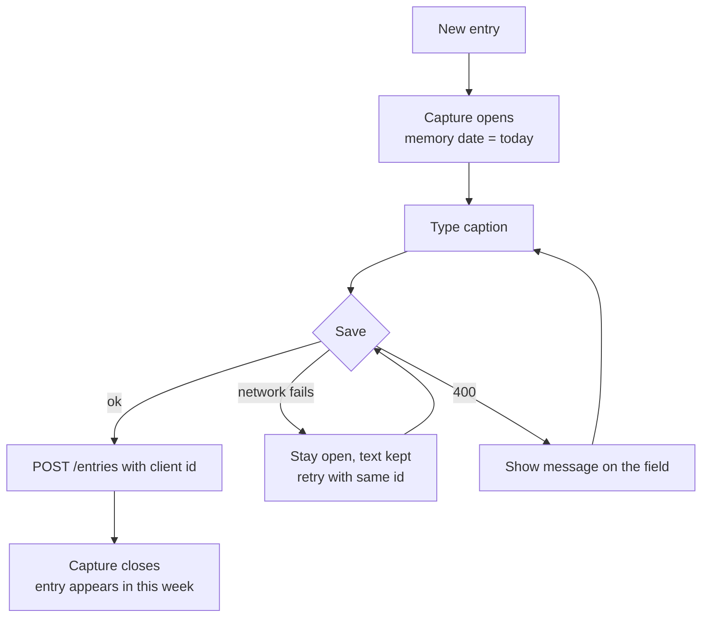
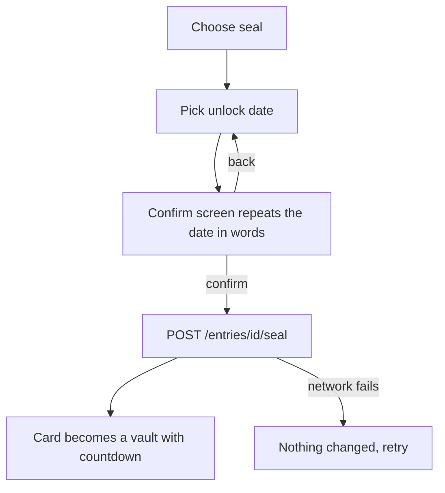

# User Flows: memoirist

> **Draft, written before any design exists.** It describes what the user does and what happens, step by step, including when things go wrong. It deliberately says nothing about look and feel: screen names, button labels and wording are placeholders in *italics* until `docs/design/DESIGN.md` exists.
>
> Sources: the [README](../README.md), [PRD.md](PRD.md), [API_CONTRACT.md](API_CONTRACT.md), [DECISIONS.md](DECISIONS.md). If this file disagrees with them, they win (the README on what and when, DECISIONS.md on how, D-27). Gaps found while writing are listed at the end.

## How to read this file
- Each flow has an ID (`F-xx`). Playwright tests in task 4.13 and later are named after them, for example `f06-seal-entry.spec.ts`.
- **Happy path** is the normal route. **Edge cases** cover mistakes, failures and limits.
- `API` shows the call behind a step, so each flow can be checked against the contract.
- "Today" always means today in the user's timezone (D-07).

## Flow index

| ID | Flow | Phase |
|---|---|---|
| F-01 | First open | 1 |
| F-02 | Quick text entry | 1 |
| F-03 | Entry with photos and a voice note | 1 |
| F-04 | Add a paper diary page | 1 |
| F-05 | Change an entry's memory date (backdating) | 1 |
| F-06 | Seal an entry as a Loot Drop | 1 |
| F-07 | Living with a sealed entry | 1 |
| F-08 | Browse the feed | 1 |
| F-09 | Edit or delete an entry | 1 |
| F-10 | Create Eras and change their dates | 1 |
| F-11 | Create and use a template | 1 |
| F-12 | Name, close and reopen a week | 1 |
| F-13 | Change display name or timezone | 1 |
| F-14 | Things going wrong (applies to every flow) | 1 |
| F-15 | Open a week's summary | 1 |
| F-16 | Scan every entry in the timeline | 1 |
| F-17 | Tag entries and browse by tag | 1 |
| F-18 | Bring back a deleted entry | 1 |
| F-20…F-25 | Later phases (outlines only) | 2–6 |

---

## F-01 First open
**Who / when:** someone opening the app for the first time. In Phase 1 that is always the seeded dev user; there is no login.
**Starts from:** the app's home address.

**Happy path**
1. The app loads the user (`GET /users/me`) and the first page of the feed (`GET /feed`).
2. The feed is empty, so an *empty state* explains the idea in one or two lines and offers one action: *write your first memory* (→ F-02).

**Edge cases**
| Situation | What the user sees |
|---|---|
| Backend not running | A full-page *can't reach memoirist* message with *try again* (F-14) |
| Feed empty but eras or templates exist | Still the empty state; eras appear once a week has entries |

---

## F-02 Quick text entry
**Who / when:** the user wants to jot something down now.
**Starts from:** a *new entry* action available from every main screen.

**Happy path**
1. The capture view opens with an empty editor and the memory date set to today. If a draft was left from last time, it is restored (D-23).
2. The user types. A title, tags (F-17) and formatting (headings, lists, bold, links) are all optional.
3. The user saves. The app sends `POST /entries` with an `id` it generated, the date, the title, the caption and any `tagIds`.
4. The capture view closes. The feed shows the entry at the top, inside the current week. If this is the week's first entry, the week appears too (D-08).

**Edge cases**
| Situation | What the user sees | API |
|---|---|---|
| No title, no text and no media | *Save* stays disabled (D-23) | — |
| Network drops while saving | Capture stays open with the text intact and a *retry* option. Retrying reuses the same `id`, so it never creates two entries | `POST /entries` replay → `200` |
| Pastes something huge (over 200 KB) | Message on the editor: too long to save | `413 payload-too-large` |
| Pastes a `javascript:` link | The link is dropped by the editor; if it reaches the server, a field message | `400 validation-failed` |
| Closes capture with unsaved text | Asked *keep editing* or *discard*. A reload or crash keeps the draft (D-23) | — |

---

## F-03 Entry with photos and a voice note
**Who / when:** the user wants a post with pictures and/or a recording, with or without a caption.
**Starts from:** the capture view (F-02).

**Happy path**
1. The user adds photos (file picker or camera) and/or records a voice note. Each item shows as a thumbnail in a *staging strip*.
2. They drag thumbnails into the order they want.
3. They optionally write a caption and change the date.
4. On save, in this order (D-10, TECH_STACK §3):
   1. create the entry (`POST /entries`, client `id`)
   2. upload each item (`POST /entries/{id}/media`), showing progress per item
   3. set the final order (`PUT /entries/{id}/media/order`)
5. The entry appears in the feed with its carousel in the chosen order.

**Edge cases**
| Situation | What the user sees | API |
|---|---|---|
| More than 10 items | The 11th can't be added; a short note says 10 is the limit | `400` if it gets through |
| A file over 25 MB | That item is marked *too large* before upload; the rest continue | `413` |
| An unsupported file (HEIC, video, PDF…) | That item is marked *not supported* | `415` |
| One upload fails partway (network) | The entry is saved with the items that made it. Failed items stay in the strip with *retry* or *remove* (D-23) | — |
| Every upload fails and there's no title or text | The app deletes the empty entry, which is erased at once rather than kept in Recently deleted (D-30), and keeps the files in the strip to retry (D-23) | `DELETE /entries/{id}` |
| Storage is down | Same as above, with a *try again later* message | `503 storage-unavailable` |
| Microphone permission denied | A message explaining how to allow it; photos still work | — |
| Browser can't record a supported format | Voice note button hidden or explained | — |
| Photo only, no caption | Allowed: a photo-only post (D-05) | — |

---

## F-04 Add a paper diary page
**Who / when:** the user writes on paper and wants a page in their timeline (D-20). Phase 1 stores a page as a photo marked as a page; reading the handwriting is Phase 3 (F-23).
**Starts from:** the capture view.

**Happy path**
1. The user photographs the page or picks the photo, and marks it as a diary page.
2. They set the memory date to the day the page is about, which is usually in the past (→ F-05 rules).
3. Optionally they add more pages to the same entry (up to 10) and a short caption.
4. Save as in F-03. The entry is filed into the week of that date, so it may appear far down the feed rather than at the top.

**Edge cases**
| Situation | What the user sees |
|---|---|
| The entry lands in an old week | After saving, a toast names its week with *go there* (D-23) |
| The phone saves HEIC | The picker should hand over JPEG; if not, `415` as in F-03 (D-17, verify in Sprint 4) |

---

## F-05 Change an entry's memory date (backdating)
**Who / when:** while creating (F-02/F-03/F-04) or editing (F-09).

**Happy path**
1. The user opens the date picker. Today is selected; future days can't be chosen (D-09).
2. They pick an earlier day and save.
3. The entry is filed into that day's week, which is created if needed. If they changed the date of an existing entry, it leaves its old week; a week left with no entries disappears from the feed.

**Edge cases**
| Situation | What the user sees | API |
|---|---|---|
| Device clock or timezone says a different "today" | The app uses the user's timezone setting, not the device's | — |
| A future date reaches the server | Field message on the date | `400 validation-failed` |
| A date before 1900 (a typo such as 0202) | The picker doesn't offer it; if it reaches the server, a field message (D-09) | `400 validation-failed` |
| Entry is sealed | Date can't be changed (F-07) | `409 entry-sealed` |

---

## F-06 Seal an entry as a Loot Drop
**Who / when:** the owner, after the entry and all its media are saved (D-10: seal last).
**Starts from:** an entry's *more actions* menu, or a *seal* option at the end of capture.

**Happy path**
1. The user chooses *seal*. A short explanation says that **nobody, including them, can open or change it until then**, and that it can still be deleted.
2. They pick an unlock day. Past days and today are unavailable. It opens at 09:00 on that day in their timezone (D-23).
3. A confirmation repeats the date and time in words and how far away it is ("Opens Thursday 21 October 2027 at 9:00 am — in 1 year"). This catches typos like 2072 for 2027.
4. They confirm. The app calls `POST /entries/{id}/seal`.
5. The card turns into a *vault card*: the memory date, the unlock date and a countdown. No title, caption, photos or tags are visible.

**Edge cases**
| Situation | What the user sees | API |
|---|---|---|
| Uploads still in progress | *Seal* is unavailable until they finish | — |
| Network fails | *Not sealed — try again*; the entry is unchanged | — |
| Date more than 100 years ahead | Field message | `400` |
| Already sealed | This becomes "extend" (F-07) | — |

---

## F-07 Living with a sealed entry
**Who / when:** any time between sealing and the unlock moment.

**Happy path**
1. The vault card shows in its week like any other entry, with a live countdown in the user's timezone.
2. When the unlock time passes, the entry appears in an *Opened* strip at the top of the feed until the user opens or dismisses it (`GET /entries/opened`, `POST /entries/{id}/mark-seen`, D-10). Its card in its own week shows the full entry again. How the opening looks is a design choice for DESIGN.md.

**What the user can and can't do while it is sealed**
| Action | Result | API |
|---|---|---|
| Open it | Sees only the vault card | `GET` returns redacted entry |
| Edit title, caption, date, template, tags or media | Not offered. If attempted, *This memory is sealed until …* | `409 entry-sealed` |
| Extend the unlock date | Allowed: pick a later date, confirm as in F-06 | `POST …/seal` later date |
| Bring the date earlier | Not offered | `409 entry-sealed` |
| Delete it | Allowed. It moves to *Recently deleted*, still sealed; if it isn't restored within 30 days it is erased unseen (D-30, F-18) | `DELETE /entries/{id}` |

**Edge cases**
| Situation | What the user sees |
|---|---|
| Countdown hits zero while the card is on screen | The card refreshes itself and opens |
| It unlocks while the user is away | It waits in the Opened strip until they next open the app |
| User changes timezone | The countdown and unlock date display in the new zone; the moment itself doesn't change |

---

## F-08 Browse the feed
**Who / when:** the main screen.

**Happy path**
1. Above the weeks, an *Opened* strip shows any Loot Drops that have just opened (F-07). Weeks are listed newest first, each with its date range, optional title and its entries in day order (API_CONTRACT §WeeklyLog).
2. Weeks are grouped under sticky Era headers. A week in several Eras appears once, under the Era that started most recently, with the other Eras as chips (Q18 default). Weeks in no Era sit under a neutral heading.
3. Scrolling down loads the next page (`GET /feed?page=n`) until there are no more.
4. Each entry card shows its title (if any), carousel (swipe, arrow keys or buttons), caption and tags. Voice notes play inline.
5. Tapping a week's header opens its summary (F-15). A *show all entries* switch opens the timeline (F-16).

**Edge cases**
| Situation | What the user sees |
|---|---|
| Tab left open for over an hour | Photos would break because links expire after 60 minutes; the app refetches when the tab regains focus, so they keep working |
| One card fails to render | That card shows a small error; the rest of the feed works |
| Loading the next page fails | A *retry* at the bottom; already-loaded weeks stay |
| `prefers-reduced-motion` | No swipe or unlock animations |

---

## F-09 Edit or delete an entry
**Starts from:** an entry's *more actions* menu.

**Happy path: edit**
1. The capture view opens with the entry's title, caption, date, template, tags and media.
2. The user changes any of them: add, remove or reorder media; edit text; change tags; change date (F-05).
3. Save sends `PUT /entries/{id}` for title, text, date, template and tags, and the media calls from F-03 for media changes. Removing a photo is `DELETE /media/{id}`. Removing the last photo from an entry with no title or text offers to delete the entry instead (D-23).

**Happy path: delete**
1. The user chooses *delete*. A short confirmation says it moves to *Recently deleted*, where it can be restored for 30 days (F-18).
2. `DELETE /entries/{id}`; the card disappears, and so does its week if it was the last entry (D-30).

**Edge cases**
| Situation | What the user sees | API |
|---|---|---|
| Entry is sealed | Only *extend seal* and *delete* are offered (F-07) | `409` otherwise |
| Edited on another device meanwhile | Last save wins (D-23) | — |
| Entry no longer exists | *This memory was deleted*; the feed refreshes | `404` |

---

## F-10 Create Eras and change their dates
**Who / when:** whenever the user wants to name a chapter of life.
**Starts from:** an *Eras* screen, or a week's *Eras* chip in the feed.

**Happy path**
1. *Eras* lists chapters newest first. The user creates one with a title, start date, optional end date (blank = ongoing) and optional description (`POST /eras`).
2. Every week whose dates overlap the Era is in it at once, including old weeks and backdated entries (D-22). The feed regroups those weeks under the right header.
3. To change what an Era holds, the user changes its dates (`PUT /eras/{id}`). There's no way to add or remove a single week; tags cover themes that don't follow dates. Eras can overlap, so a trip can sit inside a longer chapter.
4. Opening an Era shows its weeks, counting only the entries inside its dates (`GET /eras/{id}`).

**Edge cases**
| Situation | What the user sees | API |
|---|---|---|
| End date before start date | Field message | `400` |
| Changing an Era's dates | It holds the weeks the new dates overlap, straight away | `PUT /eras/{id}` |
| An Era that starts or ends mid-week, such as a weekend trip | The week is listed, but only the days inside the Era's dates count | `GET /eras/{id}` |
| Delete an Era | Confirmation says entries are kept; only the Era goes | `DELETE /eras/{id}` |
| A new or backdated entry falls inside an Era's dates | It is in the Era automatically (D-22) | — |

---

## F-11 Create and use a template
**Starts from:** a *Templates* screen, or *use a template* in capture.

**Happy path**
1. The user creates a template with a name and up to 20 prompts, for example "Spiralling Check-in" (`POST /templates`).
2. In capture they choose *use a template*. Its prompts are inserted as headings at the top of the editor; they can be edited or deleted like any text (D-06).
3. Save as usual; the entry remembers which template it started from.

**Edge cases**
| Situation | What the user sees |
|---|---|
| Template chosen after typing | Headings are inserted above the existing text (D-23) |
| A prompt left empty | Its heading is removed when the entry is saved (D-06) |
| A template entry in the timeline | Its preview skips the template headings, so entries aren't all named after the first prompt (D-24) |
| Template edited or deleted later | Existing entries are unchanged |
| No templates yet | *Use a template* links to creating one |

---

## F-12 Name, close and reopen a week
**Starts from:** a week's header in the feed.

**Happy path**
1. The user gives the week a title, for example "Grampians Trip Week" (`PUT /weekly-logs/{id}`).
2. When the week feels done, they choose *close week* (`POST …/close`). In Phase 1 this only marks it. From Phase 3 it writes the weekly summary, and a *Wrap up* card at the top of the feed offers the latest finished week with one tap (D-28, F-22).
3. A closed week can still be edited, and *reopen* undoes the close.

**Edge cases**
| Situation | What the user sees |
|---|---|
| Closing a week that has a sealed entry | Allowed. From Phase 3 the summary simply leaves the sealed entry out |
| Closing the current week early | Allowed; new entries still go into it |

---

## F-13 Change display name or timezone
**Starts from:** *Settings*.

**Happy path**
1. The user edits their display name or picks a timezone from a searchable list (`PATCH /users/me`).
2. Every time and countdown in the app updates to the new zone, and "today" follows it.

**Edge cases**
| Situation | What the user sees |
|---|---|
| Moving to a zone where it's already tomorrow | New entries default to the new "today". Existing entries keep their memory dates and weeks; nothing is re-filed (dates are calendar days) |
| Travelling without changing the setting | Times stay in the saved zone, by design |

---

## F-14 Things going wrong (every flow)
| Situation | Behaviour |
|---|---|
| Server unreachable | Reads show *can't reach memoirist* with retry; anything being written stays on screen and can be retried with the same `id` |
| `400 validation-failed` | Message next to the field named in `fieldErrors`; nothing else on the screen is lost |
| `404 not-found` | *This no longer exists*, then back to the feed |
| `409 entry-sealed` | *This memory is sealed until …* |
| `413` / `415` | Per-item message on the file (F-03) |
| `500` / `503` | General *something went wrong, try again*; no technical detail |
| Slow request | Progress shown after a short delay; buttons can't be pressed twice |

---

## F-15 Open a week's summary
**Who / when:** the user wants an overview of one week before diving into its entries (D-25).
**Starts from:** tapping a week's header in the feed (or a week listed on an Era page).

**Happy path**
1. The week summary opens (`GET /weekly-logs/{id}`): title, dates, Eras, how many entries, photos and voice notes, a few thumbnails, and the tags used that week.
2. Below that, one **bar per entry**, in day order: its display title (title → first line of the caption that isn't a heading → *Photo* / *Diary page* / *Voice note*, D-24), the day, and small icons for photos or voice notes.
3. Tapping a bar opens that entry.
4. From the summary the user can also rename, close or reopen the week (F-12). Its Eras follow from their dates (F-10).
5. From Phase 3, the AI-written weekly summary appears at the top of this view (F-22).

**Edge cases**
| Situation | What the user sees |
|---|---|
| A sealed entry in the week | Its bar shows only a lock, the day and the unlock date |
| Every entry in the week deleted | The week disappears until one is restored (F-18); the user is returned to the feed |

---

## F-16 Scan every entry in the timeline
**Who / when:** the user wants to see everything at a glance, without cards or summaries (D-25).
**Starts from:** a *show all entries* switch or menu item.

**Happy path**
1. Every entry is listed newest first, one row each: display title, date, media icons and tags (`GET /entries`).
2. Scrolling loads more pages.
3. Choosing a tag filters the list to that tag (`GET /entries?tagId=…`).
4. Tapping a row opens the entry.

**Edge cases**
| Situation | What the user sees |
|---|---|
| A sealed entry | A row with a lock, its memory date and unlock date; no title or tags. It is left out while a tag filter is on (D-10) |
| No entries match a tag | *No entries with this tag yet* and a way to clear the filter |

---

## F-17 Tag entries and browse by tag
**Who / when:** while writing or editing, or when tidying up (D-26). Manual in Phase 1; the AI can suggest tags from Phase 3 (F-22).

**Happy path**
1. In capture, a tag picker shows the user's tags; typing a new name creates one (`POST /tags`).
2. The chosen tags are saved with the entry (`tagIds` on `POST` / `PUT /entries`).
3. Tags appear on entry cards, week summaries and timeline rows. Tapping one opens the timeline filtered by it (F-16).
4. A *Tags* screen lets the user rename or delete tags (`PUT` / `DELETE /tags/{id}`). Deleting a tag removes it from entries but leaves the entries alone.

**Edge cases**
| Situation | What the user sees | API |
|---|---|---|
| Creates a tag that already exists with different capitals | The existing tag is used | `POST /tags` → `200` |
| Renames to an existing name | Message suggesting the other tag | `409 conflict` |
| More than 20 tags on one entry | The picker stops at 20 | `400` |
| Entry is sealed | Tags hidden and can't be changed | `409 entry-sealed` |
| Tag counts on the *Tags* screen | Never count sealed entries (D-10) | `GET /tags` |

---

## F-18 Bring back a deleted entry
**Who / when:** the user deleted an entry and wants it back, or wants it gone for good, within 30 days (D-30).
**Starts from:** a *Recently deleted* screen, reached from *Settings* or the timeline.

**Happy path**
1. *Recently deleted* lists deleted entries, most recently deleted first: display title, memory date and the day it will be erased (`GET /entries/deleted`).
2. The user chooses *restore*. The entry goes back to its week with its media, tags and seal as they were, and the week reappears if it had gone (`POST /entries/{id}/restore`).
3. Or they choose *erase now* and confirm. The entry and its media are erased at once (`POST /entries/{id}/erase`).

**Edge cases**
| Situation | What the user sees | API |
|---|---|---|
| A sealed entry | Only its memory date and unlock date. Restoring keeps the seal | `GET /entries/deleted` |
| 30 days pass | A daily sweep erases it, and it leaves the list | — |
| An old link or bookmark to a deleted entry | *This memory was deleted* (F-14) | `404` |
| An empty entry (no title, caption or media) | Never listed: it is erased as soon as it's deleted | `DELETE /entries/{id}` |

---

## Later phases (outlines only)
These are kept short on purpose. Expand each one when its sprint is next, after its open questions are settled.

| ID | Flow | Phase | Key rules | Open questions |
|---|---|---|---|---|
| F-20 | Register, log in, log out | 2 | Same screens after login as Phase 1 | Q2 |
| F-21 | Share an entry or week by link; revoke it | 2 | Sealed entries stay redacted on shared pages | Q2, Q19 |
| F-22 | Give AI consent; *Help me think* while writing; accept suggested tags; close a week (often from the *Wrap up* card) and read its summary at the top of F-15; close an Era and read its summary; manage friend profiles and explore the friendship map; search by word or by feeling | 3 | Nothing sent until a tap; never on sealed entries; two-option cards only (D-21); summaries only for closed weeks and Eras (D-28) | Q6, Q14, Q17, Q23 |
| F-23 | *Read this page* on a diary photo; review the transcript; use it as the caption; accept a detected date | 3 | Read only on a tap; the transcript is a suggestion, saved only through the normal edit (D-20) | Q12 |
| F-24 | Install the app; capture offline; sync later; scan mode; unlock notifications | 4 | Client `id`s make retries safe | Q7, Q13, Q24, Q25 |
| F-25 | Create a trip group, or start one from an entry; invite; contribute and withdraw entries; group Loot Drop; trip Era | 5 | Contributions are links; personal endpoints never widen (D-19) | Q8–Q11, Q26 |
| F-26 | Insight inbox; highlight reels; writing coach | 6 | Opt-in, capped, dismissible, never chat (D-21) | Q15, Q16 |

---

## Gaps found while drafting
All eight gaps (G-01 to G-08) were settled on 2026-10-27: G-01 to G-07 in D-23, and G-08 in D-25 (with D-24 entry titles and D-26 manual tags following from it).

G-09 to G-13, found while syncing the docs with the README, were settled the same day: sealed entries in tag filters and counts (G-09, D-10), surfacing opened Loot Drops (G-10, D-10), previews of template entries (G-11, D-06 and D-24), sample content for building the UI (G-12, task 3.11), and the earliest memory date (G-13, D-09).

New gaps go here with the next number until they are recorded with `/record-decision`.

| # | Question | Needed by | Suggested default |
|---|---|---|---|
| — | None open | — | — |
