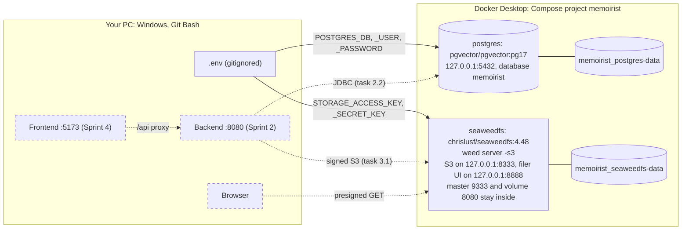

# Sprint 1: Setup and local infrastructure

> **Tasks:** 1.1 to 1.3 ([SPRINT_PLAN](../../SPRINT_PLAN.md)) · **Branch:** `phase-1-sprint-1` · **Built:** 2026-10-25 to 2026-10-29

## The goal
Get everything ready before any application code exists: a repo that Claude Code works in by the project's rules (1.1), a machine with the right tools (1.2), and the two data services the backend will talk to (1.3). Sprint 2 starts writing Java on top of all three. The README's Phase 1 promises nothing new to users here; this sprint is the ground the core journal is built on.

## How the tasks fit together
| Task | What it gave the tasks after it | Journal |
|---|---|---|
| 1.1 Claude Code setup and specs in Markdown | `CLAUDE.md`, the specs (README, DECISIONS, SPRINT_PLAN and the rest), the rules, skills and hooks in `.claude/`, `.gitignore` and `.env.example` | None: it came before the journal |
| 1.2 Machine prerequisites | JDK 25, a running Docker engine, Node 24, and a `.env` that git ignores | [1.2](1.2-machine-prerequisites.md) |
| 1.3 Docker Compose: Postgres and SeaweedFS | Postgres 17 and SeaweedFS 4.48 on this machine, credentials from `.env`, signed-only S3, and a V1 schema already shown to apply cleanly | [1.3](1.3-docker-compose.md) |

Each task leaned on the one before it. Task 1.3 was the first to *use* `.env`: Compose refuses to start without its five variables, so its first `docker compose up -d` confirmed what 1.2 could only infer from timestamps.

## The architecture at the end of the sprint
Solid lines exist now; dashed ones arrive in later sprints.



Tests from Sprint 2 onwards don't use these containers. Testcontainers starts its own Postgres ([D-14](../../DECISIONS.md#d-14-testing-and-ci)) and SeaweedFS from the same images ([TECH_STACK §1](../../TECH_STACK.md#1-local-development)), which is why 1.3 chose the SeaweedFS version with test start-up in mind ([D-03](../../DECISIONS.md#d-03-object-storage-seaweedfs-locally-cloudflare-r2-in-production)).

## Test strategy
There's no application code yet, so every check is a command whose exit code and output are the evidence, quoted in each task's §7.
- **Positive checks** for each Done-when item: `java -version`, `docker info`, both services healthy, `psql` reaching `memoirist`, a signed S3 call.
- **Negative checks** where a control should refuse: an unsigned S3 request gets `403`, an empty key stops Compose, and a retired key gets `InvalidAccessKeyId`.
- **Secrets stay in `.env`.** Git answered the questions about `.env` in 1.2; in 1.3 Docker read it into throwaway containers, and logs were scrubbed by value before anyone read them.
- **One look ahead:** the V1 and seed SQL from DATABASE_SCHEMA.md ran against a throwaway database, so task 2.3 starts from SQL that's known to work.

From Sprint 2, checks become JUnit and Testcontainers tests that run with `./gradlew test`.

## How to run everything
Git Bash, repo root. Nothing here prints a `.env` value.

```bash
java -version                        # 25.x (task 1.2)
docker info --format '{{.ServerVersion}}'
node -v                              # v24.x
docker compose up -d && docker compose ps                            # both "(healthy)"
docker compose exec -T postgres psql -c 'select current_database()'  # memoirist
curl -s -o /dev/null -w '%{http_code}
' http://127.0.0.1:8333/     # 403: unsigned S3 is refused
```

The signed S3 check (Docker reads `.env` into a throwaway aws-cli container) and the V1 check are in [1.3 §6](1.3-docker-compose.md#6-how-it-was-tested); the 1.2 checks are in [1.2](1.2-machine-prerequisites.md).

## Lessons
1. **A program's environment is a copy made when it started.** `JAVA_HOME` was right in Windows and wrong in the running session (1.2).
2. **"Confirm against the docs for that version" can mean reading the source.** SeaweedFS's wiki, and so D-03, said a config file makes it ignore the environment variables; the 4.48 code merges them (1.3).
3. **Measure the defaults you depend on.** Docker's grace period before SIGKILL was about 3 s on this machine, not the documented 10 s (1.3).
4. **Check every entrance.** S3 on 8333 needs keys; the filer on 8888 serves the same files to anyone, so only the loopback binding protects it (1.3).
5. **The newest release isn't automatically the right one.** Read the issues opened since; 4.50 and 4.51 added a 15-second first write (1.3).
6. **Redaction has to cover derived values,** such as a prefix of a key inside a log line (1.3).

## Before Sprint 2
- Restart Claude Code so it picks up `JAVA_HOME` (task 1.2, §8). Until then every Gradle command needs `JAVA_HOME` set in the same shell command.
- V1's two inline `UNIQUE` constraints keep Postgres's default names (`users_email_key`, `media_object_key_key`), not the `uq_<table>_<cols>` convention. This unattended run goes on to task 2.3, which copies V1 as written, so once V1 is committed a rename needs a new migration (V2). Recorded as an assumption in [OVERNIGHT_REPORT.md](../../OVERNIGHT_REPORT.md) (task 1.3, §7).
