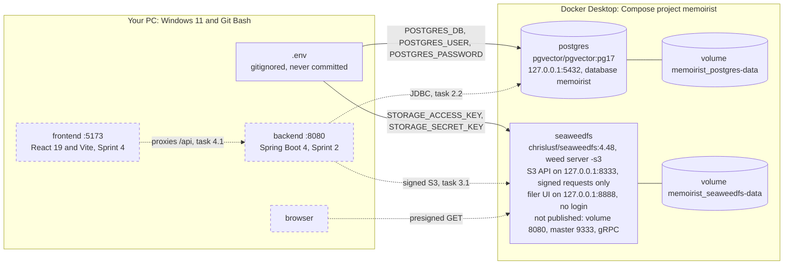

# Sprint 1: Setup and local infrastructure

> **Tasks:** 1.1 to 1.3 ([SPRINT_PLAN](../../SPRINT_PLAN.md#sprint-1-setup-and-local-infrastructure)) · **Branch:** `phase-1-sprint-1`, with a pull request into `phase-1` · **Built:** 2026-10-25 to 2026-10-29 · **Status:** all three tasks done, and every **Done when** check passed
> **Built:** a repo set up for Claude Code (1.1), a machine shown to have the right tools (1.2), and Postgres 17 and SeaweedFS running from `docker-compose.yml` (1.3). There's no application code yet.

## The goal
Sprint 1 gets everything ready before any application code exists, so that Sprint 2 can start writing Java against a working database and object store. It has three tasks:
- **1.1** sets up the repo: the specs, `CLAUDE.md`, and the rules, skills and hooks that hold Claude Code to them.
- **1.2** checks that this machine has what the build needs: JDK 25, a running Docker engine, Node 22 or later, and a `.env` that git ignores.
- **1.3** starts the two data services the backend will use: Postgres 17 for the journal's tables, and SeaweedFS as the local S3 store for photos and voice notes.

Nothing on the README's Phase 1 list reaches users in this sprint. It's the ground the core journal stands on: CLAUDE.md's Phase 1 line says the journal is "Local only, with a seeded dev user", and these are the local services it runs on.

## How the tasks fit together, in build order
| Task | What it needed from the task before | What it gave the tasks after it |
|---|---|---|
| **1.1** Claude Code setup and specs in Markdown | Nothing: it's the first task | The rules and specs every later task reads: `CLAUDE.md`; the docs (README, DECISIONS, SPRINT_PLAN with each task's **Done when** list, TECH_STACK, DATABASE_SCHEMA with the V1 SQL, DEVELOPMENT); `.claude/` (rules, skills, the migration guard and the `.env` deny rules); `.gitignore` with its `.env` rule; `.env.example`; and `.mcp.json` for context7 |
| **1.2** Machine prerequisites | `.env.example` to copy, the `.env` rule in `.gitignore`, `.mcp.json`, and the check commands in DEVELOPMENT.md §1 | Evidence that JDK 25 (for 2.1), a Docker engine with Compose (for 1.3 and every Testcontainers test), Node 24 (for 4.1) and an ignored `.env` (for 1.3 and 2.2) are in place. Two findings for 2.1: this session's `JAVA_HOME` is stale, and Java 25 needs Gradle 9.1.0 or later |
| **1.3** Docker Compose: Postgres and SeaweedFS | The running Docker engine and the `.env` from 1.2; TECH_STACK §1, D-03, D-04 and the V1 SQL from 1.1 | Postgres 17 on `127.0.0.1:5432` with database `memoirist` (for 2.2 and 2.3); signed-only S3 on `127.0.0.1:8333` (for 3.1); the pinned SeaweedFS tag that 3.1's test container reuses (D-03, Version); and V1 SQL already shown to apply cleanly (for 2.3) |

Each task tested something the task before it could only promise on paper:
- 1.1's `.gitignore` says `.env` is ignored. 1.2 proved it with git, without opening the file.
- 1.2 judged from timestamps that `.env` has every variable `.env.example` lists. 1.3's first `docker compose up -d` was the first real test: Compose refuses to start unless its five variables are set, and a signed S3 call and a password login over TCP showed the values work. The remaining variables are first read by the backend's `local` profile, from task 2.2.
- 1.1's DATABASE_SCHEMA.md holds the V1 SQL that task 2.3 copies into a Flyway migration. 1.3 ran it, and the seed, against a throwaway database, so 2.3 starts from SQL that's known to work.

## Task entries
| Task | Commit | Journal entry | Spec review |
|---|---|---|---|
| 1.1 Claude Code setup and specs in Markdown | [`51e05ea`](https://github.com/aarrroon/memoirist/commit/51e05ea802c9f47b531a7135f2e24d26ef89de61) on `main` (2026-10-25), then later spec commits before the run | None: it came before the journal | None |
| 1.2 Machine prerequisites | [`47c29ff`](https://github.com/aarrroon/memoirist/commit/47c29ffecdce7abeb8d312eceacd1851bfdc9632) | [1.2 Machine prerequisites](1.2-machine-prerequisites.md) | Pass with notes: 3 minor findings, all fixed |
| 1.3 Docker Compose: Postgres and SeaweedFS | [`3447288`](https://github.com/aarrroon/memoirist/commit/344728896e4c7277c1ec6c7eb186f190f135ff46) | [1.3 Docker Compose](1.3-docker-compose.md) | Pass with notes: 5 minor findings, all fixed |

Each entry names its commit by title, because a commit can't contain its own hash; the hashes are here. The sprint's pull request shows the whole diff.

**Practice blocks:** none this sprint. Both tasks are setup and configuration: you asked to skip them for 1.2, and the learn-later style never puts them in config files. Each entry ends with eight *Check yourself* questions instead.

## The architecture at the end of the sprint
Drawn from [`docker-compose.yml`](../../../docker-compose.yml). Solid boxes and lines exist now; dashed ones arrive in later sprints.



- **Everything listens on `127.0.0.1` only.** The filer on 8888 has no login and serves the same files that S3 protects, so the loopback binding is what keeps other machines out ([1.3 §4](1.3-docker-compose.md#4-decisions-and-alternatives)).
- **Credentials have one home, `.env`.** Compose fills them in when it creates the containers, and maps the two storage keys to SeaweedFS's `AWS_ACCESS_KEY_ID` and `AWS_SECRET_ACCESS_KEY`. `${VAR:?}` makes Compose refuse to start when one is missing or empty, because SeaweedFS with no keys accepts every request unsigned ([D-03](../../DECISIONS.md#d-03-object-storage-seaweedfs-locally-cloudflare-r2-in-production)).
- **Data lives in two named volumes.** They survive `stop`, restarts and `--force-recreate`; only `docker compose down -v` deletes them.
- **SeaweedFS is one process,** `weed server -s3`: master, volume server, filer and S3 gateway. The volume server's 8080 stays inside the container, so it can't clash with the backend's 8080.
- **No bucket yet.** The backend's `local` profile creates `memoirist-media` in task 3.1 ([TECH_STACK §2](../../TECH_STACK.md#2-backend-backend)).

## Test strategy
### This sprint: commands as tests
Nothing is unit-tested or integration-tested yet, because there's no application code: `docker-compose.yml` is the only file that runs. So each **Done when** item is a command, and its exit code and output are the evidence.
- **Where to find them:** each entry's §6 lists every check, what it proves and its type, with the commands to rerun it; §7 quotes the decisive output for each **Done when** item.
- **Positive checks** for every **Done when** item: `java -version`, `docker info`, `node -v`, and `.env` present and ignored (1.2); both services healthy, `psql` reaching `memoirist`, and a signed S3 call creating and listing a bucket (1.3).
- **Negative checks**, where a control must refuse: an unsigned S3 request gets `403`, an empty variable stops Compose, and a retired key gets `InvalidAccessKeyId` (1.3). A security control you've never seen fail hasn't been tested.
- **Look-ahead checks** for later tasks: the V1 and seed SQL on a throwaway database, with constraint probes in a rolled-back transaction (for 2.3); a timed first write on a fresh SeaweedFS 4.48 (for 3.1's tests); and `--force-recreate`, to show the volumes keep their data and the keys reload.
- **Secrets stay in `.env`.** No check opened it. Git answered the questions about it in 1.2. In 1.3, Docker read it into throwaway containers (`--env-file .env`), and the logs were scanned for its values by count only.

Every **Done when** check and every extra check passed. The one problem the checks found was this session's stale `JAVA_HOME` (1.2), which isn't a **Done when** item. Three things weren't checked: a first start on empty volumes with the final file (`down -v` needs your approval, and the run was unattended), whether the filer sends permissive CORS headers, and the `winpty` row in DEVELOPMENT.md §7.

### From Sprint 2: JUnit and Testcontainers
None of this exists yet. It's the plan in [D-14](../../DECISIONS.md#d-14-testing-and-ci) and `.claude/rules/backend.md` (Testing), and it's why two of 1.3's choices look past Compose.

| Kind | What it covers | How it runs | Why this kind |
|---|---|---|---|
| Unit tests | Pure logic: `WeekCalendar`, `EntryContentValidator`, `ContentTextExtractor`, `EntryMapper` | Plain JUnit 5 with a fixed `Clock`, no Docker | Fast, and a fixed clock makes "today" and week boundaries repeatable |
| Integration tests | Anything that touches the database or storage, and every endpoint: the happy path, `400`, `404` for another user's resource, and `409 entry-sealed` | `@SpringBootTest` with Testcontainers: `pgvector/pgvector:pg17` wired by `@ServiceConnection`, and SeaweedFS as a `GenericContainer` on the D-03 tag, shared across test classes through one base class or config | No H2: it can't emulate JSONB, `TIMESTAMPTZ` behaviour or deferrable constraints (D-14). 1.3's V1 check used one: swapping two media positions works only because `uq_media_entry_order` waits until commit |

The tests won't use the Compose containers:

| | Compose (this sprint) | Testcontainers (from Sprint 2) |
|---|---|---|
| Started by | You: `docker compose up -d` | `./gradlew test`, and CI from task 2.7 |
| Lives | Until you stop it; the data stays in named volumes | One test run; removed afterwards |
| Ports | Fixed: 5432, 8333 and 8888 on `127.0.0.1` | Random free ports, handed to Spring |
| Used for | Running the app (`bootRun` with the `local` profile) | Tests (the `test` profile) |
| Images | `pgvector/pgvector:pg17` and `chrislusf/seaweedfs:4.48` | The same images |

That's why 1.3 chose the SeaweedFS version with tests in mind. Testcontainers starts a fresh server for every run, and on 4.50 or 4.51 the first upload of each run would wait about 15 seconds ([1.3 §4](1.3-docker-compose.md#4-decisions-and-alternatives)).

## How to run everything
Git Bash, from the repo root. Nothing here prints a `.env` value. The full list, with ports and troubleshooting, is in [DEVELOPMENT.md](../../DEVELOPMENT.md).

**Check the machine** (task 1.2):

```bash
java -version                                # openjdk version "25.0.x" ... LTS
docker info --format '{{.ServerVersion}}'    # answers only while Docker Desktop is running
node -v                                      # v22 or later (v24 here)
test -f .env && echo ".env exists"           # first time: cp .env.example .env, then fill in the values
git check-ignore -q .env && echo ".env is ignored"
```

**Run the data services** (task 1.3, [DEVELOPMENT.md §4](../../DEVELOPMENT.md#4-everyday-commands)):

```bash
docker compose up -d                 # start; both "(healthy)" in docker compose ps within about 10 seconds
docker compose ps                    # status
docker compose exec postgres psql    # SQL shell in database memoirist (\q to quit)
docker compose logs -f               # follow logs (Ctrl+C); SeaweedFS's first lines show the S3 access key ID
docker compose stop                  # stop and keep the data (SeaweedFS takes about 17 seconds)
docker compose down -v               # DELETES all local data: database and uploads
```

If `docker compose exec postgres psql` says `the input device is not a TTY`, Git Bash's own window isn't a Windows console. Prefix the command with `winpty` (not tested here) or use Windows Terminal. A one-off query needs no terminal: `docker compose exec -T postgres psql -c 'select 1'`.

**Check that it works** (1.3's **Done when** items, short form):

```bash
docker compose exec -T postgres psql -c 'select current_database()'   # memoirist
curl -s -o /dev/null -w '%{http_code}\n' http://127.0.0.1:8333/        # 403: unsigned S3 is refused
```

The signed S3 check (Docker reads `.env` into a throwaway `amazon/aws-cli` container) and the V1 check are in [1.3 §6](1.3-docker-compose.md#6-how-it-was-tested).

**Two commands print secrets,** so don't paste their output anywhere: `docker compose config` prints the file with every `${VAR}` filled in, and `docker inspect <container>` prints a container's environment (ask for one field with `--format` instead).

**From Sprint 2, Gradle needs JDK 25 in `JAVA_HOME`** (task 1.2, [§8](1.2-machine-prerequisites.md#8-what-went-wrong)). The wrapper starts Java from `$JAVA_HOME/bin/java` whenever `JAVA_HOME` is set, and stops if that folder doesn't exist. Windows' saved value is already JDK 25, but a Claude Code session started before it changed still carries an old `jdk-22` folder that no longer exists. Quit Claude Code completely, reopen it, and check `echo "$JAVA_HOME"`; if it's still old, sign out of Windows and back in. Until then, set it in the same command:

```bash
cd backend && export JAVA_HOME="/c/Program Files/Eclipse Adoptium/jdk-25.0.5.8-hotspot" && ./gradlew test
```

**Later sprints,** from [CLAUDE.md](../../../CLAUDE.md). Each line works once the task it names is done:

```bash
docker compose up -d                                                      # 1.3: data services
cd backend && ./gradlew bootRun --args='--spring.profiles.active=local'   # 2.1: API on :8080, /swagger-ui.html
cd backend && ./gradlew test                                              # 2.1: Testcontainers needs Docker running
cd backend && ./gradlew spotlessApply                                     # 2.1: format Java
cd frontend && npm run dev                                                # 4.1: :5173, proxies /api to :8080
cd frontend && npm test && npm run lint && npm run typecheck              # 4.1
cd frontend && npm run gen:api                                            # 4.2: regenerate API types (backend must be running)
```

## Lessons
### What went wrong
The details, with the error messages, are in each entry's §8.

| Task | What went wrong | How it was found and fixed |
|---|---|---|
| 1.2 | The run's brief said `JAVA_HOME` pointed to an old JDK 22. It pointed to a folder that no longer exists. The first guess, Git Bash mangling the path, was wrong too | `test -d`, cmd's `if exist`, `reg query` and PowerShell's three scopes: Windows' saved value is right, and this session inherited the old one when it started. The fix is a restart, yours to do |
| 1.2 | A line-ending alarm: `grep -c $'\r$'` claimed every line ended in a carriage return | Counting the bytes (`tr -cd '\r' < file \| wc -c` printed `0`) and `git ls-files --eol` (`i/lf w/lf`) showed a false positive |
| 1.3 | A quick `docker compose stop` was really a kill: SIGKILL about 3 s after SIGTERM, exit `137`. SeaweedFS needs about 17 s to stop cleanly | `docker events` and the exit code. `-volume.preStopSeconds=1` plus `stop_grace_period: 30s` give exit `0` in 18.7 s |
| 1.3 | The newest SeaweedFS releases, 4.50 and 4.51, make the first write on a fresh server wait about 15 s | The issues opened since those releases (seaweedfs#12145), then a timed write: 0.21 s on 4.48. So 4.48 is pinned |
| 1.3 | SeaweedFS's wiki, and so D-03, said an identity file makes it ignore the `.env` keys. The 4.48 code merges them | Reading `auth_credentials.go` at the 4.48 tag. D-03's explanation was corrected; the decision didn't change |
| 1.3 | An `E` line in the log at every start, and two catalog servers (Iceberg and Lance) that nobody asked for | Reading the log, then `netstat -tln` inside the container. Three flags switch them off |
| 1.3 | The log scrubber caught the exact access key ID but not its first 8 characters inside `name=admin-…`, which reached the session's output. Not the repo, and the key ID, not the secret | Every later read redacted that field too |
| 1.3 | A misleading timing: the AWS CLI's own start-up was most of a "4.1 s first write" | Signed `curl --aws-sigv4` in a one-off container: 0.24 s |
| Both | The spec reviews found eight minor findings, all in the docs, and no blocker or major one. Among them: a misquote (D-02), misattributed sources (CLAUDE.md's words credited to the README; D-14 cited for what D-03 and TECH_STACK say), a run report that contradicted its journal, and a promise the unattended run couldn't keep | All fixed in each task's close-out |

### What recurred
1. **The description was wrong; the measurement was right.** The run's brief (`JAVA_HOME`), SeaweedFS's wiki (the identity merge), Docker's docs (a 10-second grace period; about 3 s measured here) and Docker's getting-started page on health checks (looser than what Docker does) were all off. Each time, the answer came from running something or reading the source, not from another doc. When a doc and the running system disagree, believe the system, then fix the doc, as D-03 was.
2. **Quoting across nested shells broke twice:** PowerShell inside bash (1.2), and SQL inside `sh -c` inside Git Bash (1.3). Each fix removed a layer: a `.ps1` file run with `-File`, and SQL sent on stdin through a quoted heredoc (`<<'SQL'`). Git Bash also rewrites arguments that look like paths before Docker sees them; `MSYS_NO_PATHCONV=1` stops it.
3. **Secrets came close but never reached a commit.** The `.env` guard refused a `stat` (1.2, working as intended); a prefix of the access key ID reached the session's output (1.3); `env` ran once against the run's rules and printed only a count (1.3); and the run report printed a personal folder path in full (1.2's review). The pattern both tasks settled on: let tools read `.env` themselves (Compose, `docker run --env-file`), and redact derived values, not just exact ones. A false alarm came last: when the pull request opened, GitGuardian, the secret scanner on this repo, flagged `docker-compose.yml` line 15 as a password. The line is `POSTGRES_PASSWORD: ${POSTGRES_PASSWORD:?set POSTGRES_PASSWORD in .env}`, a placeholder, not a value. Scanners match patterns, so triage each alert: open the flagged line, confirm it's a reference rather than a value, and resolve it as a false positive.
4. **A fact written in two places drifted.** The `JAVA_HOME` fix differed between the run report and the 1.2 entry, and the SeaweedFS tag was written out in three docs (1.3). Both reviews fixed it the same way: one home for the fact, and links to it. D-03's Version bullet is now the tag's only home.
5. **Some outputs only looked like answers.** A line-ending count, a fast stop and a CLI timing each measured something else. Check the exit code, count the bytes, and time the inner operation.

### What to look at first in review
1. **[`docker-compose.yml`](../../../docker-compose.yml)**, the sprint's only file that runs (79 lines): the `${VAR:?}` guards on all five credentials (lines 13–19 and 58–59), `127.0.0.1` on every published port (21 and 61–62), the seven SeaweedFS flags and their reasons (37–55), `stop_grace_period` (68), and the two health checks (24–31 and 69–75).
2. **[D-03](../../DECISIONS.md#d-03-object-storage-seaweedfs-locally-cloudflare-r2-in-production), lines 76–79 of DECISIONS.md.** An agent corrected a decision's explanation from SeaweedFS's source code and added the Version bullet. The reviewer was offline and couldn't check the source. Do you accept the claim and the pin?
3. **V1's two default-named `UNIQUE` constraints**, `users_email_key` and `media_object_key_key` ([1.3 §7](1.3-docker-compose.md#7-proof-each-done-when-item)). The convention is `uq_<table>_<cols>`. Task 2.3 commits V1 as written, so renaming them later means a V2 migration.
4. **[DEVELOPMENT.md §7](../../DEVELOPMENT.md#7-troubleshooting), lines 120–124 and 129:** the rows these tasks added or changed. They're the runbook you'll reach for when something breaks.
5. **Each entry's §4 table** (decisions and alternatives): the reasoning most likely to come up at work.

## Open items carried into Sprint 2
- **Clear GitGuardian's false positive** on the sprint's pull request: resolve incident 39228980 (`docker-compose.yml` line 15) as a false positive in GitGuardian's dashboard. Later files that read a password from `.env` by name may be flagged the same way.
- **Restart Claude Code** so it picks up Windows' `JAVA_HOME` (above). Until then, every Gradle command sets it in the same shell command.
- **Task 3.1's test container** uses D-03's SeaweedFS tag, not `latest`.
- **Not verified:** a first start on empty volumes with the final file; the filer's CORS headers (worth a `curl -I -H 'Origin: https://example.com' http://127.0.0.1:8888/` before Sprint 4 serves pages); and the `winpty` fix.
- **Docker kills containers about 3 s after SIGTERM** on this machine, not the documented 10 s. SeaweedFS is covered by `stop_grace_period`; other projects' containers may not be.
- Everything else is in [OVERNIGHT_REPORT.md](../../OVERNIGHT_REPORT.md), under *Assumptions* and *Needs attention*.
