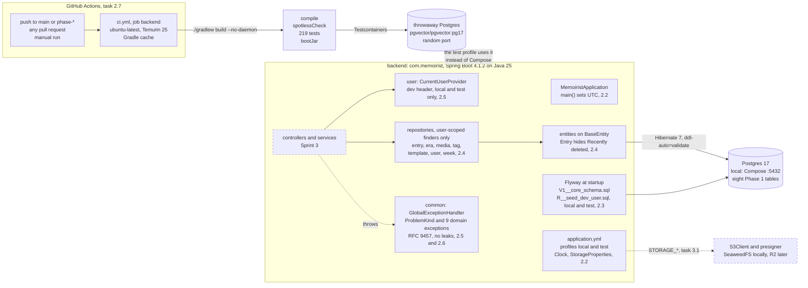

# Sprint 2: Backend foundation

> **Tasks:** 2.1 to 2.7 ([SPRINT_PLAN](../../SPRINT_PLAN.md#sprint-2-backend-foundation)) · **Branch:** `phase-1-sprint-2`, stacked on `phase-1-sprint-1` · **Built:** 2026-10-30 to 2026-10-31 (Melbourne time, by the commit timestamps) · **Status:** all seven tasks built, reviewed and closed out. Task 2.7 was built and reviewed with its Done-when item "the workflow passes on GitHub" still pending; the close-out pushed the branch, the first run was green ([run 41060170384](https://github.com/aarrroon/memoirist/actions/runs/41060170384), 219 tests), and only then was 2.7 ticked in the SPRINT_PLAN (see [its entry's §7](2.7-ci-backend.md#7-proof-each-done-when-item))
> **Built:** a Spring Boot 4 backend that starts, reads its configuration, owns the Phase 1 database, maps its tables to entities, knows who is calling, answers every error in one shape, and has a GitHub Actions workflow that builds and tests it on every push to `main` or a `phase-*` branch and every pull request (the first run on GitHub passed; see the status line). It has no API endpoints yet; those are Sprint 3. The sprint's pull request is stacked on Sprint 1's, so it shows only this sprint's diff; merge it after that one.

## The goal
Sprint 1 left a machine with the right tools and two running data services. Sprint 2 writes the first Java against them, and builds everything an endpoint will stand on, so that Sprint 3 can write endpoints without stopping to decide how configuration, the schema, ownership or errors work. It has seven tasks:
- **2.1** creates the `backend/` Gradle project on Spring Boot 4.1.2 and Java 25, with Flyway, JPA, Actuator, springdoc, the AWS S3 SDK, Spotless and Testcontainers, and a smoke test that proves the app is up and talks to Postgres.
- **2.2** adds the configuration: UTC everywhere, the `Clock`, Hibernate set to validate-only, upload limits, the `local` and `test` profiles, and `StorageProperties`, a validated record that stops the app at startup when a storage setting is wrong.
- **2.3** creates the schema. `V1__core_schema.sql` makes the eight Phase 1 tables, and a repeatable seed adds the dev user in the `local` and `test` profiles only.
- **2.4** maps the tables: seven entities on two base classes, and seven repositories that can only look things up for a given user.
- **2.5** answers "who is calling?": `CurrentUserProvider` and its dev-only implementation that reads `X-Dev-User-Id`.
- **2.6** gives every error one shape: the RFC 9457 problem types from the API contract, nine domain exceptions, `fieldErrors`, and no stack trace, SQL or echoed input in a response.
- **2.7** runs `./gradlew build` on GitHub for every push to `main` or a `phase-*` branch and every pull request, so a change that breaks the build can't go unseen.

Nothing on the README's Phase 1 list reaches users yet. This sprint is the base the core journal is built on. CLAUDE.md's non-negotiables 1, 2, 3 and 7 (migrations, UTC, the current user, the dev header only in dev profiles) get their foundation here, each with a test that fails if the foundation is removed. Numbers 4 and 6 (sealed entries, validated content) start with the mapper and the content validator in Sprint 3.

## How the tasks fit together, in build order
| Task | What it needed from the task before | What it gave the tasks after it |
|---|---|---|
| **2.1** Spring Boot project | JDK 25 and a running Docker engine (1.2), Postgres on :5432 (1.3), the stack choices in D-02, D-14 and D-15 | A `backend/` project that builds: pinned versions, the Gradle wrapper with its checksum, Spotless, Testcontainers wired to `pgvector/pgvector:pg17`, and `ApplicationSmokeTest`. A review finding that `gradlew` would lose its executable bit, fixed before the commit |
| **2.2** Configuration and profiles | The project and its smoke test; `.env.example` (1.1) | `main()` sets UTC; the `Clock` bean; `ddl-auto=validate`; the `local` and `test` profiles; `StorageProperties`; `@IntegrationTest`, which gives a test class the full app and one shared Postgres container |
| **2.3** V1 migration and seed | The profiles (Flyway's locations differ per profile); the V1 SQL that 1.3 had already run once on a throwaway database | The eight tables and the dev user (`00000000-0000-0000-0000-000000000001`) that the next tasks use, and four test classes on what the database refuses and what it deletes with a parent row |
| **2.4** Entities and repositories | The V1 tables and `ddl-auto=validate`, which stops the app if an entity and the schema disagree | `User`, `Era`, `Template`, `WeeklyLog`, `Entry`, `Media`, `Tag`; `BaseEntity` and `TimestampedEntity` (D-12); repositories with user-scoped finders only; `@SQLRestriction` hiding Recently deleted entries |
| **2.5** Current user resolution | The dev user (2.3) and the profiles (2.2) | `CurrentUserProvider`; the dev-header provider with a strict parser; the first `GlobalExceptionHandler` and its `malformed-request` problem; a way to test HTTP behaviour before any endpoint exists |
| **2.6** Global error handling | 2.5's handler to extend, the `Clock` for timestamps, API_CONTRACT's Errors table | `ProblemKind`, nine domain exceptions, `fieldErrors`, `ScrubbedException` so logs don't hold entry content, and the rule that no service writes its own error body |
| **2.7** CI: backend | Everything above, as one command: `./gradlew build` | `.github/workflows/ci.yml`: the same build on a clean Linux machine for every push to `main` or a `phase-*` branch and every pull request. Sprint 3 starts with a safety net |

Each task tested something the one before it could only promise:
- 2.1's review warned that `gradlew` would be committed without its executable bit. 2.7 checked it twice: `git ls-files -s` says `100755`, and a Linux container ran `./gradlew` from a `git archive` of the commit.
- 2.2 gave the `test` profile its own settings, so tests need no `.env`. 2.7 builds from a checkout that has no `.env`.
- 2.3's seed is what lets 2.5 test "a missing header falls back to the dev user" against a real row.
- 2.5 added a one-handler `GlobalExceptionHandler` on purpose, so 2.6 would extend a class instead of inventing a second one.
- 2.4's `@SQLRestriction` and 2.6's error handling meet in `ErrorHandlingIntegrationTest`: a stale edit and a unique-key violation are real Hibernate and Postgres errors there, not mocks.

## Task entries
| Task | Commit | Journal entry | Spec review |
|---|---|---|---|
| 2.1 Spring Boot project | [`c50510f`](https://github.com/aarrroon/memoirist/commit/c50510f4e4d14050cd274660955206d7895a0e9e) | [2.1 Spring Boot project](2.1-spring-boot-project.md) | Changes needed: 1 major (fixed), 3 minor (2 fixed, 1 left to you) |
| 2.2 Configuration and profiles | [`173761e`](https://github.com/aarrroon/memoirist/commit/173761e55e2928b53ef996cfebd417e17f934fa3) | [2.2 Configuration and profiles](2.2-configuration-and-profiles.md) | Pass with notes: 2 minor findings, one fixed and one left to you |
| 2.3 V1 migration and seed | [`830b0ac`](https://github.com/aarrroon/memoirist/commit/830b0ac02bd883fd310dd254d82ca9e16cebade7) | [2.3 V1 migration and seed](2.3-v1-migration-and-seed.md) | Pass with notes: 3 minor findings, 2 fixed |
| 2.4 Entities and repositories | [`da285ac`](https://github.com/aarrroon/memoirist/commit/da285ac0e476f4f9ec6d629ce8f2c01bfc619f77) | [2.4 Entities and repositories](2.4-entities-and-repositories.md) | Pass with notes: 6 minor findings, some left as follow-ups |
| 2.5 Current user resolution | [`661fd59`](https://github.com/aarrroon/memoirist/commit/661fd593d65fa6734ab9846219cdf2c37f5989f5) | [2.5 Current user resolution](2.5-current-user-resolution.md) | Pass with notes: 3 minor findings, all fixed |
| 2.6 Global error handling | [`fe9fb49`](https://github.com/aarrroon/memoirist/commit/fe9fb498cb2d194c55c0c6eb833ad320cfa857fe) | [2.6 Global error handling](2.6-global-error-handling.md) | Changes needed: 1 major, 5 minor; fixed in a close-out pass |
| 2.7 CI: backend | [`6ffd71c`](https://github.com/aarrroon/memoirist/commit/6ffd71cb3df03fcd553191ff343018302789d93c) (the workflow and its docs), then [`4cd786a`](https://github.com/aarrroon/memoirist/commit/4cd786a801927e030addbdb4219c808abd62f34b) (ticked the task after the green run) | [2.7 CI: backend](2.7-ci-backend.md) | Changes needed twice, both times because the GitHub run was still pending (1 blocker each), plus 3 minor (2 fixed, 1 left to you); the first run was then green. See the entry's §9 |

Each entry names its commit by title; the hashes are here. The sprint's pull request shows the whole diff. `backend/` gained 74 files and about 7,000 lines, all of it before 2.7, which adds one workflow file and no Java. The whole sprint, docs and journal included, is 94 files and about 9,300 added lines. Two commits come after the tasks: `Sprint 2: add the build journal overview` (this wrap-up, the second CI run in the 2.7 entry, the commit hashes and the overnight report) and `Sprint 2: link the pull request in the overnight report`.

**Practice blocks left in the code** (`TODO(human) PRACTICE`; the answer sits inside each block, so the build passes with it in place). Try each before you read its answer:

| Task | File | What it teaches |
|---|---|---|
| 2.1 | [`ApplicationSmokeTest.java:25`](../../../backend/src/test/java/com/memoirist/ApplicationSmokeTest.java#L25) | Proving the app is UP *and* that Postgres is one of the checks behind it; `RestTestClient` with `jsonPath` |
| 2.2 | [`StorageProperties.java:34`](../../../backend/src/main/java/com/memoirist/storage/StorageProperties.java#L34) | A validated `@ConfigurationProperties` record that fails fast at startup |
| 2.2 | [`StoragePropertiesTest.java:82`](../../../backend/src/test/java/com/memoirist/storage/StoragePropertiesTest.java#L82) | `ApplicationContextRunner`: assert that the app refuses to start, and names each wrong setting |
| 2.3 | [`SchemaConstraintsTest.java:137`](../../../backend/src/test/java/com/memoirist/db/SchemaConstraintsTest.java#L137) | Asserting that Postgres refuses a bad row, by the constraint's name |
| 2.3 | [`DeferredUniqueConstraintTest.java:86`](../../../backend/src/test/java/com/memoirist/db/DeferredUniqueConstraintTest.java#L86) | A `DEFERRABLE INITIALLY DEFERRED` constraint and `TransactionTemplate`: it fails at commit, not at the statement |
| 2.4 | [`BaseEntity.java:33`](../../../backend/src/main/java/com/memoirist/common/BaseEntity.java#L33) | `Persistable` and JPA lifecycle callbacks: one INSERT, no SELECT, for an entity with a preset id |
| 2.4 | [`EntryRepositoryTest.java:70`](../../../backend/src/test/java/com/memoirist/entry/EntryRepositoryTest.java#L70) | The ownership (IDOR) test: Bob can't read Alice's entry through any finder |
| 2.5 | [`DevHeaderCurrentUserProvider.java:54`](../../../backend/src/main/java/com/memoirist/user/DevHeaderCurrentUserProvider.java#L54) | Strict input parsing at a trust boundary |
| 2.5 | [`CurrentUserHttpTest.java:95`](../../../backend/src/test/java/com/memoirist/user/CurrentUserHttpTest.java#L95) | A `@WebMvcTest` slice with a test-only controller; assert the whole error contract |
| 2.6 | [`FieldErrors.java:32`](../../../backend/src/main/java/com/memoirist/common/FieldErrors.java#L32) | One string per field, in a stable order, with `computeIfAbsent` and `TreeMap` |
| 2.6 | [`GlobalExceptionHandlerTest.java:313`](../../../backend/src/test/java/com/memoirist/common/GlobalExceptionHandlerTest.java#L313) | `OutputCaptureExtension`: a 500 hides its message from the client and keeps it, scrubbed, in the log |
| 2.7 | none | A workflow file is configuration; its entry teaches through eight *Check yourself* questions instead |

## The architecture at the end of the sprint
Solid boxes exist now. Dashed ones arrive in Sprint 3 or later.



- **One place for each rule.** Ownership lives in the repositories (every finder takes the user's id). Time lives in the `Clock` and UTC. Errors live in `GlobalExceptionHandler`. Who is calling lives in `CurrentUserProvider`. A service in Sprint 3 uses these; it doesn't re-decide them.
- **The schema is the contract, twice.** Flyway builds it, and `ddl-auto=validate` makes Hibernate refuse to start when an entity and a table disagree. The database also refuses bad rows itself (`CHECK`, `UNIQUE`, deferrable order constraints), and tests check each of those by constraint name.
- **Profiles decide who the caller is.** `local` and `test` have the dev-header provider and the seed; any other profile has neither, and a test starts the app under `prod` to prove it.
- **CI doesn't test a different thing.** It runs the command a developer runs, on a machine with nothing of yours on it: no `.env`, no Compose, no Windows line endings.

## Test strategy
### What this sprint built
Sprint 1 had commands as tests. Sprint 2 is the first real test code: 219 tests by the end of 2.6, all run by `./gradlew build` and, once the branch is pushed, by CI.

| Kind | What it covers | How it runs | Examples |
|---|---|---|---|
| Plain unit tests | Pure logic: the field-error map, the problem-type list against the API contract, the header parser, the storage settings | JUnit (Jupiter 6) and AssertJ, with no Spring or with an `ApplicationContextRunner`; no Docker | `FieldErrorsTest`, `ProblemKindTest`, `DevHeaderCurrentUserProviderTest`, `StoragePropertiesTest` |
| Web slices | HTTP behaviour before any endpoint exists: a `@TestComponent` controller that lives only in test code | `@WebMvcTest` with `RestTestClient`; no database, no Docker | `CurrentUserHttpTest`, `GlobalExceptionHandlerTest` |
| Integration tests | The full app against real Postgres: schema, constraints, mapping, finders, ownership, real errors | `@IntegrationTest` (test profile, `RestTestClient`, Testcontainers): one app and one container shared by every class that uses it | `SchemaTest`, `SchemaConstraintsTest`, `EntityMappingTest`, `OwnershipFindersTest`, `EntryRepositoryTest`, `ErrorHandlingIntegrationTest` |
| Tests with their own container | Things the shared context can't show | A second Postgres container, or a second `SpringApplication` | `MigrationsTest` (Flyway alone, on empty schemas), `DevProviderAbsentInProdTest` (the app under `prod`) |

**How the 219 tests are organised.** The count grew task by task: 3 (2.1), 23 (2.2), 78 (2.3), 121 (2.4), 164 (2.5) and 219 (2.6); 2.7 added none. Tests sit in the package of the code they test. This is the count per package, from the JUnit result files of the last local build:

| Package | Tests | Classes (tests in each) | What they pin down |
|---|---|---|---|
| `com.memoirist` | 11 | `ConfigurationTest` 7, `ApplicationSmokeTest` 3, `MemoiristApplicationTest` 1 | The app starts and reports health; the settings have the values the docs promise; `main()` sets UTC |
| `common` | 59 | `GlobalExceptionHandlerTest` 31, `ErrorHandlingIntegrationTest` 9, `FieldErrorsTest` 7, `PersistableInsertTest` 5, `ScrubbedExceptionTest` 5, `ProblemKindTest` 2 | Every error shape; the base entity's one-INSERT behaviour |
| `db` | 75 | `SchemaTest` 28, `SchemaConstraintsTest` 19, `EntityMappingTest` 13, `OwnershipFindersTest` 7, `MigrationsTest` 5, `DeferredUniqueConstraintTest` 3 | The tables, what the database refuses, entity-to-column mapping, user-scoped finders, the migrations themselves |
| `user` | 43 | `DevHeaderCurrentUserProviderTest` 22, `CurrentUserProfileTest` 9, `CurrentUserHttpTest` 6, `CurrentUserWiringTest` 4, `DevProviderAbsentInProdTest` 2 | Who is calling: the header parser, which profiles have the provider, the HTTP answer to a bad header |
| `entry`, `media` | 18 | `EntryRepositoryTest` 9, `MediaRepositoryTest` 6, `EntryVersionTest` 3 | Entry and media finders, Recently deleted hidden, stale edits |
| `storage` | 13 | `StoragePropertiesTest` 13 | The storage settings the app refuses to start without |

Four helpers in the test root are not tests: `IntegrationTest` (the one annotation for integration tests), `TestcontainersConfiguration` (one `PostgreSQLContainer` bean on the image Compose runs, wired in with `@ServiceConnection`), `Fixtures` (plain unsaved objects with random ids and a unique email, so tests never collide on a `UNIQUE` constraint) and `SqlLog` (captures the SQL Hibernate runs, so a test can assert on the statements without changing Spring's configuration and losing the shared context).

- **No H2.** It can't do JSONB, `TIMESTAMPTZ` behaviour or deferrable constraints, and the schema uses all three (D-14).
- **Tests that can fail.** From 2.2 on, each task broke its own code on purpose (a mutation check) and watched for a failing test: delete the UTC line in `main`, drop `@OrderBy`, parse a header with `UUID.fromString`, put `@ResponseStatus` on a handler. Several tests passed on their first run and proved nothing until this was done (2.2, 2.4, 2.5 and 2.6 each list what it caught).
- **Assert the contract, not just the status.** Error tests check the problem `type`, `title`, `instance`, a parsed `timestamp`, the content type, and that nothing the client sent comes back.
- **The database is the last line of defence.** Constraint tests assert the constraint's name, because a type-only check passes when the wrong rule fires.

### What 2.7 adds
CI runs the same build somewhere else. It catches what only another machine can: a file that needs `.env`, a path with the wrong case, a CRLF file, a missing executable bit, a JDK that isn't 25. It says nothing about the frontend (task 4.17), and it doesn't replace a reviewer. The 2.7 entry builds the project in a Linux container first (its §6), because a pull request is a slow way to find a first-run failure.

## How to run everything
Git Bash, from the repo root. The full list, with ports and troubleshooting, is [DEVELOPMENT.md](../../DEVELOPMENT.md).

**Gradle needs JDK 25 in `JAVA_HOME`** (task 1.2, [§8](../sprint-1/1.2-machine-prerequisites.md#8-what-went-wrong)). This session's value is stale, so set it in the same command:

```bash
cd backend && export JAVA_HOME="/c/Program Files/Eclipse Adoptium/jdk-25.0.5.8-hotspot" && ./gradlew build
```

```bash
docker compose up -d                                                      # data services (the app needs them; the tests don't)
cd backend && ./gradlew bootRun --args='--spring.profiles.active=local'   # API on :8080; /actuator/health says UP
cd backend && ./gradlew test                                              # tests only (Docker must be running)
cd backend && ./gradlew spotlessApply                                     # format Java; run it before `build` on this machine
cd backend && ./gradlew build                                             # compile, spotlessCheck, tests, jar: what CI runs
cd backend && ./gradlew test --tests '*EntryRepositoryTest'               # one test class
gh run list --workflow ci.yml --limit 5                                   # CI runs on GitHub (task 2.7)
```

Tests don't use the Compose containers: each run starts its own Postgres on a random port. The app does need Compose, because `bootRun` uses the `local` profile.

## Lessons
### What went wrong
The details, with the error messages, are in each entry's §8.

| Task | What went wrong | How it was found and fixed |
|---|---|---|
| 2.1 | A checksum "file" was Cloudflare's `301 Moved Permanently` page. It would have gone into `gradle-wrapper.properties` as a hash | `curl -sSL` follows the redirect, and the jar's hash was checked against Gradle's published value |
| 2.1 | The review's one major finding: `gradlew` would be committed as `100644` (this checkout has `core.filemode=false`), and CI would fail with `Permission denied` | `git add --chmod=+x` before the commit; `git ls-files -s` shows `100755`. 2.7 re-checked it in a Linux container |
| 2.2 | The UTC test couldn't fail: deleting the line in `main()` left it green | A mutation check showed it, so `MemoiristApplicationTest` runs the real `main()` from another time zone |
| 2.3 | Two `MigrationsTest` tests failed: Flyway adds a `SCHEMA` row to the history when it creates the schema | The first run's failure output; the test filters the history by `type = 'SQL'` |
| 2.4 | Hibernate picked Jackson 2 and could not store a Jackson 3 `JsonNode` | `gradlew dependencies` showed both Jacksons on the classpath; one property names `Jackson3JsonFormatMapper` |
| 2.4 | A reasoning error: `Long` versus `long` for `@Version` mattered less than believed | The mutation check disproved it, and the entry says so |
| 2.5 | Several tests passed for the wrong reason, or mutations broke compilation instead of behaviour | Splitting the mutations so each pointed at one test; a fixed `Clock` instead of "close to now" |
| 2.6 | Spring's own errors (404, 405, 413) had no problem `type`; a French `Accept-Language` got French messages; `server.error.*` did nothing in Boot 4 | Printing the bodies; `javap` on `ErrorMvcAutoConfiguration`; the locale pinned and the Boot 4 property names tested |
| 2.6 | The review's major finding: the log of a `500` held the exception message, and a Postgres `CHECK` failure message contains the failing row (an entry's title and text) | `ScrubbedException` at every log site, and a test that asserts both what the log has and what it lacks |
| 2.3 to 2.7 | Again and again a bulk edit failed without saying so: a heredoc that wrote nothing, `perl` or `sed` patterns that matched nothing, a call to a Python Store shortcut | `grep` after every edit. A change you haven't read back isn't a change |
| 2.7 | The builder marked the unobserved GitHub run as met through a fallback that only applies when no remote exists, and the review caught it | The item was described as pending the first run, nothing was ticked until the close-out pushed and the run was green (it was). More in [its entry's §8](2.7-ci-backend.md#8-what-went-wrong) |

### What recurred
1. **Passing on the first run proved little.** 43 tests went green first time in 2.4 and 42 in 2.5, and mutation checks then found tests that couldn't fail. Break the code on purpose, and watch the test go red for the right reason.
2. **Spring Boot 4 isn't the Boot 3 in most examples.** One starter per technology, health components hidden by default, `spring.web.error.*` instead of `server.error.*`, Jackson 3 beside Jackson 2, JUnit 6, Testcontainers 2. Each surprise was settled by running something or reading the library, not by another example.
3. **Windows line endings.** `core.autocrlf=true` makes Spotless expect CRLF locally while git stores LF (2.1). Some docs are CRLF in the working tree (`API_CONTRACT.md`) and most are LF (2.3, 2.5, 2.6), and Git Bash's `grep` hides carriage returns. `git ls-files --eol` is the judge. CI is the first LF-only checkout.
4. **The review found what the builder couldn't see from inside.** The executable bit (2.1) and the log leak (2.6) were both major, and both were invisible to a green build.
5. **Rules were read more strictly over time.** "No stack traces in responses" became "nothing the client sent comes back" (2.6) and then "nor in the log" (the review). When a rule is about leaks, test the places you didn't think of.

### What to look at first in review
1. **[`GlobalExceptionHandler`](../../../backend/src/main/java/com/memoirist/common/GlobalExceptionHandler.java) and [`ProblemKind`](../../../backend/src/main/java/com/memoirist/common/ProblemKind.java).** Every error leaves through here, so a mistake leaks to everyone. Check the 500 path and what the log keeps.
2. **[`Entry`](../../../backend/src/main/java/com/memoirist/entry/Entry.java) and [`EntryRepository`](../../../backend/src/main/java/com/memoirist/entry/EntryRepository.java).** `@SQLRestriction` hides Recently deleted entries; two native queries bring them back. Any native query you add must say `deleted_at IS NULL` itself. The guard for sealed Loot Drops (non-negotiable 4) is `EntryMapper`, which doesn't exist yet.
3. **[`DevHeaderCurrentUserProvider`](../../../backend/src/main/java/com/memoirist/user/DevHeaderCurrentUserProvider.java).** The profile guard and the strict parser. If `local` ever reached production, anyone could be anyone.
4. **[`V1__core_schema.sql`](../../../backend/src/main/resources/db/migration/V1__core_schema.sql).** Committed now; editing it breaks every local database. The two default-named `UNIQUE` constraints would need a V2 to rename.
5. **[`.github/workflows/ci.yml`](../../../.github/workflows/ci.yml).** Short, but it runs other people's code on a public repository's pull requests: check the pinned SHAs, `permissions` and the triggers.
6. **Each entry's §4 table** (decisions and alternatives): the reasoning most likely to come up at work.

## Open items carried into Sprint 3
- **Task 3.2** must decide what a well-formed `X-Dev-User-Id` naming nobody does on a create (foreign key error or `404`). The provider doesn't check existence (2.5); the question is in the SPRINT_PLAN 3.2 block.
- **Task 3.11 (erase):** the last step, `delete()` of an entry that is in Recently deleted, is untested and may be a no-op (2.4, review finding 1). The Sprint 3 media task owes the seal check that `MediaRepository` doesn't do (2.4, finding 3).
- **Decisions worth recording with `/record-decision`,** because they live only in TECH_STACK or a journal entry: `open-in-view=false` (2.2), the strict header parse and no existence check (2.5), English-only machine messages (2.6), `@SQLRestriction` with repositories that expose no `findById` (2.4), and keeping V1's default constraint names (2.3). `.claude/rules/backend.md` and `api.md` don't yet mention the repository convention, all nine exceptions or the two-container exception for `MigrationsTest`; changing a rule also means changing CURRENT_SKILLS.md and CLAUDE.md.
- **A resource trade-off for you (2.6):** a file far over 25 MB can end in a dropped connection instead of a clean `413`, because Tomcat's swallow limit is 2 MB. The frontend checks size first. Raising the limit costs bandwidth on rejected uploads.
- **`MigrationsTest` starts a second Postgres** (2.3, review finding 2); it could share the app's `DataSource` and save about 10 seconds per run.
- **CI first run (2.7), green:** [run 41060170384](https://github.com/aarrroon/memoirist/actions/runs/41060170384), push of `6ffd71c`, job `Backend (build and test)` in 1m 43s (`BUILD SUCCESSFUL in 1m 30s`, 219 tests passed, 0 failed, on `ubuntu-26.04`, a cold cache). The follow-up commit `4cd786a` (the one that ticked 2.7) was green too: [run 41060857586](https://github.com/aarrroon/memoirist/actions/runs/41060857586), `BUILD SUCCESSFUL in 51s`, 219 passed, 0 failed, a warm cache. **Watch item:** the 413 test (`ErrorHandlingIntegrationTest.aFileOver25MbIs413PayloadTooLarge`) passed on the runner too, but one pass is not proof. If a later run flakes, look at that test and `max-swallow-size` first (the 2.6 trade-off above). To see runs: `gh run list --workflow ci.yml --limit 5`, then `gh run view <id> --log-failed`. GitHub warns that `ubuntu-latest` is moving to Ubuntu 26; this run already used it.
- **CI follow-ups (2.7):** decide about Gradle's `setup-gradle` v6 and its Terms of Use; consider Dependabot for the pinned actions, a wrapper-validation step, and branch protection that requires the `Backend (build and test)` check.
- **Restart Claude Code** so it picks up Windows' `JAVA_HOME` (Sprint 1). Until then, every Gradle command sets it in the same shell command.
- Everything else is in [OVERNIGHT_REPORT.md](../../OVERNIGHT_REPORT.md), under *Assumptions* and *Needs attention*.
