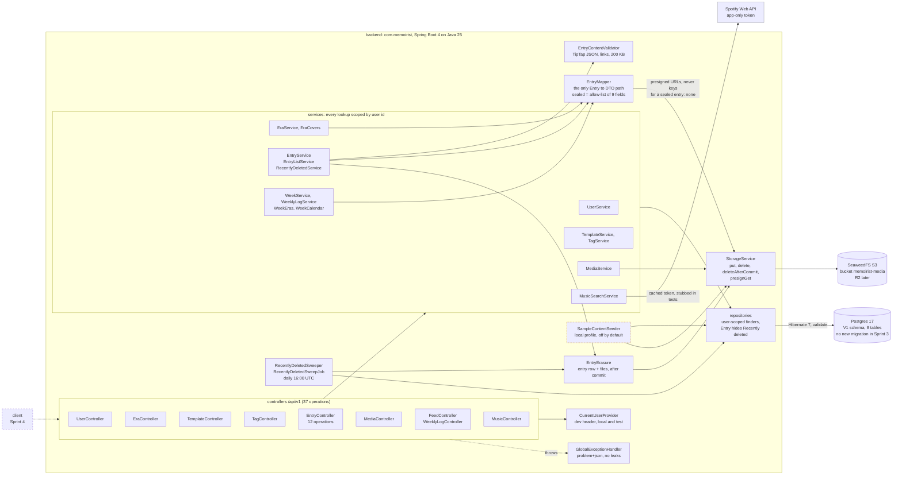

# Sprint 3: Phase 1 API

> **Tasks:** 3.1 to 3.17 ([SPRINT_PLAN](../../SPRINT_PLAN.md#sprint-3-phase-1-api)) · **Branch:** `phase-1-sprint-3`, stacked on `phase-1-sprint-2` · **Built:** 2026-10-31 to 2026-11-05 (Melbourne time, by the commit timestamps; the run was paused and resumed several times) · **Status:** all seventeen tasks built, reviewed and closed out. The last CI run on the branch (task 3.17's push) was green.
> **Built:** the whole Phase 1 backend API: 37 endpoints under `/api/v1` for the user, Eras, templates, tags, entries (with Loot Drops, replies, soundtracks and Recently deleted), media, the feed and weekly logs, the lists on the home screen, and Spotify search. Photos and voice notes go through one storage service to SeaweedFS. `/v3/api-docs` says what API_CONTRACT says. There is no frontend yet; that is Sprint 4. The sprint's pull request is stacked on Sprint 2's, so it shows only this sprint's diff; merge it after that one.

## The goal
Sprint 2 left a backend that starts, knows who is calling and answers every error in one shape, but has no endpoint. Sprint 3 builds all of them, so that Sprint 4 can write a frontend against a finished, documented API. It has seventeen tasks:
- **3.1** adds `StorageService`, the only door to object storage: put, delete, delete-after-commit and presigned URLs, on SeaweedFS locally and R2 later.
- **3.2** adds `GET` and `PATCH /users/me`, and settles what a header naming a user who does not exist does on every later create.
- **3.3, 3.4** add the Eras and Templates CRUD, the two simplest resources, and with them the pattern for a client-chosen id (replay is 200, another user's id is 409).
- **3.5** is the big one: entries, with TipTap validation, Monday weeks in the user's time zone, version checks, sealing, Recently deleted, and `EntryMapper`, the only code that turns an entry into a response, so a sealed Loot Drop cannot leak.
- **3.6** adds media upload, reorder and delete, and `EntryErasure`, the one way to erase an entry and its files.
- **3.7** adds the feed and weekly logs.
- **3.8** adds tags and `tagIds` on entries.
- **3.9 to 3.12** add the four read-only lists: the timeline, the Opened strip (with mark-seen), Recently deleted (with restore, erase and the 30-day sweep) and On this day.
- **3.13** adds Loot Drop replies and the birthday.
- **3.14** adds soundtracks and Spotify search.
- **3.15** adds Era covers.
- **3.16** adds sample content for the local profile, so Sprint 4 has something to look at.
- **3.17** compares `/v3/api-docs` with API_CONTRACT and fixes the schemas, so the frontend's generated types are right.

This completes the **Phase 1 API**. Of the README's Phase 1 list, the backend side of these is now done: entries with text, photos, voice notes and diary pages; optional titles, tags, templates and Spotify soundtracks; weeks filed automatically and joined to Eras by date, with Era covers; Loot Drops with replies and a first letter; the feed, On this day, the all-entries timeline and Recently deleted. Photo dump (D-34) and the starter template gallery are mostly client work and arrive in Sprint 4. Nothing here reaches a user yet, because there is no screen.

CLAUDE.md's non-negotiables get their enforcement here. Number 3 (never take a user ID from the request) holds in every service. Number 4 (sealed Loot Drops never leak) is `EntryMapper` plus a test that fails if any other file builds an `EntryResponse`. Number 5 (object keys only) is `StorageService.presignGet`. Number 6 (validated TipTap JSON) is `EntryContentValidator`. The sprint added no migration: `V1__core_schema.sql` already had every table and column it needed, and Sprint 3 only changed code, tests, config and docs. It added no dependency either; two things that would have needed one (ArchUnit, `JsonNullable`) were replaced by a source-scan test and a small own type.

## How the tasks fit together, in build order
| Task | What it needed from the task before | What it gave the tasks after it |
|---|---|---|
| **3.1** Storage service | Sprint 2's `StorageProperties` and the pinned SeaweedFS tag (D-03) | `StorageService`, after-commit deletion that keeps files on rollback, a `local`-only bucket bootstrap, and SeaweedFS in Testcontainers. Every later task that stores or signs a file uses it |
| **3.2** `/users/me` | The `CurrentUserProvider` (2.5) and the error handler (2.6) | The first real controller, DTO records and mapper, and the rule that every create service starts with `UserService.currentUser()` (a header naming nobody is 404) |
| **3.3** Eras CRUD | 3.2's controller pattern; `entryCount` needs entries, which do not exist yet, so it counts rows with the seal rule written into the query | The create-with-client-id logic (200 replay, 409 for another user's id), `WeekEras` (which Era holds which week, pinned first) for 3.7, and the nullable-date lesson (`cast(:to as LocalDate)`) |
| **3.4** Templates CRUD | The 3.3 pattern, copied rather than extracted | A second use of it, container-element constraints on a list, and a Java-side `Collator` ordering that 3.8 turned into `NameCollation` |
| **3.5** Entries | 3.3 and 3.4 (weeks, Eras, templates), the V1 schema, the error kinds from 2.6 | `Entry` rules (content, dates, version, seal, delete), `WeekService` (find or create the Monday week), `EntryMapper` and its sealed view, `EntryApiTest` and `MutableClock`, and the third use of the create pattern, with the Recently deleted case |
| **3.6** Media | Entries (3.5) and storage (3.1) | Upload with a per-entry row lock, reorder through the deferrable constraint, `EntryErasure`, and the discovery that `@SQLRestriction` hides a deleted entry's media from JPQL |
| **3.7** Weekly logs and feed | Entries and `EntryMapper` (3.5), media (3.6), `WeekEras` (3.3) | `PageResponse`, the feed query (a week with at least one entry, by `EXISTS`), the fixed-statement-count technique and Hibernate statistics in tests |
| **3.8** Tags | Entries (3.5) and the order helpers (3.4) | Tags, `tagIds` on entry writes, a `FOR SHARE` lock on referenced rows, `NameCollation`, and a race test pattern |
| **3.9** Timeline | The mapper (3.5), tags (3.8), media (3.6), the feed's count technique (3.7) | `EntrySummaryResponse`, `EntryMapper.toSummary`, `EntryListService`, `MediaKind` and `MediaSummary`: the row every later list returns |
| **3.10** Opened strip | The summary row (3.9) and the seal rule | A conditional bulk `UPDATE` for mark-seen, the "view mark is not an edit" rule, and the `EntrySeenMarkRaceTest` that stops anyone adding `@DynamicUpdate` to `Entry` |
| **3.11** Recently deleted | `EntryErasure` (3.6), the summary row (3.9), the Opened strip (3.10) | Restore and erase under a row lock, the daily sweep with one transaction per entry, and the finding that the fetch-by-id queries cannot serve deleted rows |
| **3.12** On this day | The summary row and the movable clock | The leap-day rule as a pure class (`OnThisDay`) and "today" in the user's zone |
| **3.13** Replies and birthday | Sealing and opening (3.5, 3.10), the lock pattern (3.8), Recently deleted (3.11) | `replyToEntryId` and `replyIds`, `BirthdayChange` (missing, `null` and a date as three states), and one more statement on pages that hold an opened Loot Drop |
| **3.14** Soundtracks | Entries, weeks and Eras (3.3, 3.5, 3.7) | `Soundtrack`, `POST /music/search` against a stubbed Spotify, and the log-capture test that no search word reaches a log line |
| **3.15** Era covers | Media (3.6), Eras (3.3), the seal rule, the lock pattern | `EraCovers` (batch lookup, hidden while sealed or deleted) and `coverMediaId` |
| **3.16** Sample content | Everything above, written through repositories and `StorageService` | `SampleContentSeeder` (local only, off by default): 3 Eras, 11 entries, 6 generated pictures, so Sprint 4 starts with a populated journal |
| **3.17** API review | All 37 endpoints | `/v3/api-docs` matches API_CONTRACT: `application/problem+json` errors, required and nullable response fields, a real `TipTapDocument`; `ApiDocsContractTest` keeps it so |

Each task leaned on something the one before it proved:
- 3.2's "every create calls `currentUser()`" is why 3.3, 3.4, 3.5, 3.8 and 3.15 each have a test for a header naming nobody.
- 3.3's `cast(:to as LocalDate)` fix is the reason 3.9's optional `tagId` and the date queries did not fail the same way.
- 3.5's "seal rule written in the query" became the template for every count and list after it: tag counts (3.8), the tag filter (3.9), the Opened strip (3.10), On this day (3.12) and Era covers (3.15) all repeat it in their own SQL, and tests fail when it is removed.
- 3.6 found that `@SQLRestriction` hides a deleted entry's media from JPQL. 3.9 predicted the same for the fetch-by-id queries, and 3.11 proved it.
- 3.8's `FOR SHARE` lock on a referenced row was reused for reply targets (3.13) and Era covers (3.15).
- 3.7's statement-count technique was reused in six more tasks (`EntryListQueryCountTest`, `EntryOpenedQueryCountTest`, `OnThisDayQueryCountTest`, `RecentlyDeletedQueryCountTest`, `EntryReplyQueryCountTest`, `EraCoverQueryCountTest`).
- 3.17 only works because 3.2 to 3.15 each had an `*ApiDescriptionTest` or an endpoint test: the review found the gaps between them, not inside them.

## Task entries
| Task | Commit | Journal entry | Spec review |
|---|---|---|---|
| 3.1 Storage service | [`f345308`](https://github.com/aarrroon/memoirist/commit/f34530888631c53e5c0ab98ef9fcd8ea948bc60a) | [3.1 Storage service](3.1-storage-service.md) | Pass with notes: 6 minor findings, 5 fixed |
| 3.2 `/users/me` | [`1414b7f`](https://github.com/aarrroon/memoirist/commit/1414b7f8baba9f3cc9f35df1560f29bb8c81e36a) | [3.2 /users/me](3.2-users-me.md) | Pass with notes: 6 minor findings, wrong daylight-saving claim removed |
| 3.3 Eras CRUD | [`e2c881a`](https://github.com/aarrroon/memoirist/commit/e2c881abdc9df44f31af466470dc6d120575054e) | [3.3 Eras CRUD](3.3-eras-crud.md) | Pass with notes: 7 findings, 3 fixed, 4 left for you |
| 3.4 Templates CRUD | [`dea448a`](https://github.com/aarrroon/memoirist/commit/dea448a45c2740f1fd71146acf0018dfd4feda14) | [3.4 Templates CRUD](3.4-templates-crud.md) | Pass with notes: 6 minor findings |
| 3.5 Entries | [`f4294cc`](https://github.com/aarrroon/memoirist/commit/f4294ccc32fd8ee973fe913f401049848af34518) | [3.5 Entries](3.5-entries.md) | Pass with notes: 4 findings, 2 doc fixes, a NUL-character case left as a follow-up |
| 3.6 Media | [`c269137`](https://github.com/aarrroon/memoirist/commit/c269137b90a5a1cbac62bded21f84ddf362eba6b) | [3.6 Media](3.6-media.md) | Pass with notes: 7 minor findings |
| 3.7 Weekly logs and feed | [`8f50db6`](https://github.com/aarrroon/memoirist/commit/8f50db61661cba1f676b142f5943e338143ed181) | [3.7 Weekly logs and feed](3.7-weekly-logs-and-feed.md) | Pass with notes: 1 major (the query count grew past 50 entries; fixed in code), 3 minor |
| 3.8 Tags | [`015776f`](https://github.com/aarrroon/memoirist/commit/015776ffbfcf38191cd392548aed8f009a13996d) | [3.8 Tags](3.8-tags.md) | Pass with notes: 5 minor findings; `tagIds` required on PUT awaits your confirmation |
| 3.9 Entry list for the timeline | [`ecd055c`](https://github.com/aarrroon/memoirist/commit/ecd055c0997ccffdd1728b5b1a82c41e1ef99b69) | [3.9 Entry list](3.9-entry-list-timeline.md) | Pass with notes: 5 minor findings, all fixed |
| 3.10 Opened Loot Drops | [`60e78b2`](https://github.com/aarrroon/memoirist/commit/60e78b2b5f39d463eba007d9f5c94f8d9ce8440f) | [3.10 Opened Loot Drops](3.10-opened-loot-drops.md) | Pass with notes: 4 minor findings; D-23 wording left for you |
| 3.11 Recently deleted | [`451467f`](https://github.com/aarrroon/memoirist/commit/451467f660ad675db709c54ff812d665e12b0690) | [3.11 Recently deleted](3.11-recently-deleted.md) | Pass with notes: 8 findings, 4 fixed |
| 3.12 On this day | [`64fd284`](https://github.com/aarrroon/memoirist/commit/64fd28422e918d757cdee3fa9fcce0ab3d20e01d) | [3.12 On this day](3.12-on-this-day.md) | Pass with notes: 4 minor findings; `dateUnknown` entries left for you |
| 3.13 Replies and the birthday | [`578a78e`](https://github.com/aarrroon/memoirist/commit/578a78e60dfd05e6bc647f6853c618d860836a0d) | [3.13 Replies and the birthday](3.13-replies-and-birthday.md) | Pass with notes: 4 minor findings |
| 3.14 Soundtracks and Spotify search | [`2a18f00`](https://github.com/aarrroon/memoirist/commit/2a18f00a372c8d2067773f7fd55073d9dcdfbad7) | [3.14 Soundtracks and Spotify](3.14-soundtracks-and-spotify.md) | Pass with notes: 4 minor findings |
| 3.15 Era covers | [`036b4ce`](https://github.com/aarrroon/memoirist/commit/036b4ce3048b44ff6e58610cb3863ead15b23bfb) | [3.15 Era covers](3.15-era-covers.md) | Pass with notes: 3 minor findings; the PUT-clears-a-hidden-cover rule left for you |
| 3.16 Local sample content | [`76c15b8`](https://github.com/aarrroon/memoirist/commit/76c15b8bde7516a18f14d747526250cdb882c50b) | [3.16 Local sample content](3.16-local-sample-content.md) | Pass with notes: 5 minor findings, the 09:00 unlock time fixed |
| 3.17 API review | [`0163494`](https://github.com/aarrroon/memoirist/commit/0163494918b60e55624bba174a6709b82ee8022b) | [3.17 API review](3.17-api-review.md) | Pass with notes: 4 minor findings |

Each entry names its commit by title; the hashes are here. The sprint's pull request shows the whole diff: 249 files and about 36,700 added lines, of which `backend/src/main` is 110 files and about 7,500 lines, `backend/src/test` is 112 files and about 25,000 lines, and the journal is 17 entries and about 3,700 lines (this overview and the report are extra). There are about three lines of test for every line of code. Two commits come after the tasks: `Sprint 3: add the build journal overview` (this file, the index row and the commit hashes in the overnight report) and `Sprint 3: link the pull request in the overnight report`.

## The endpoint map
All 37 operations of the Phase 1 API, by resource. The task is the one that built the endpoint; later tasks that added a field to it are named in the notes. The test class is where its HTTP behaviour is tested; most endpoints also have a service-level or query-level test, listed in the entry. Every path is under `/api/v1`.

| Method and path | Built in | What it does | Main test class |
|---|---|---|---|
| `GET /users/me` | 3.2 | The caller's id, email, name, time zone and (3.13) birthday | `UserEndpointTest` |
| `PATCH /users/me` | 3.2 | Name, time zone (IANA names only) and, from 3.13, birthday (missing leaves, `null` removes, a date sets) | `UserEndpointTest`, `UserUpdateRequestJsonTest` |
| `POST /eras` | 3.3 | Create with an optional client id; 3.14 and 3.15 added `soundtrack` and `coverMediaId` | `EraEndpointTest`, `EraCoverTest`, `SoundtrackEndpointTest` |
| `GET /eras` | 3.3 | The user's Eras, pinned first then latest start | `EraEndpointTest` |
| `GET /eras/{eraId}` | 3.3 | One Era with the weeks its dates overlap and each week's `entryCount` | `EraEndpointTest`, `EraWeeksTest` |
| `PUT /eras/{eraId}` | 3.3 | Full replace | `EraEndpointTest`, `EraCoverTest` |
| `DELETE /eras/{eraId}` | 3.3 | Delete the Era; weeks and entries are untouched | `EraEndpointTest` |
| `POST /templates` | 3.4 | Create with an optional client id | `TemplateEndpointTest` |
| `GET /templates` | 3.4 | By name, ignoring case and accents | `TemplateEndpointTest`, `TemplateOrderTest` |
| `GET /templates/{templateId}` | 3.4 | One template | `TemplateEndpointTest` |
| `PUT /templates/{templateId}` | 3.4 | Full replace; subheading limits | `TemplateEndpointTest`, `TemplateRequestValidationTest` |
| `DELETE /templates/{templateId}` | 3.4 | Delete; entries keep their content and lose `templateId` | `TemplateEndpointTest` |
| `POST /entries` | 3.5 | Create (client id, content, date, week filed automatically); 3.8 `tagIds`, 3.13 `replyToEntryId`, 3.14 `soundtrack` | `EntryEndpointTest`, `EntryDatesTest`, `EntryContentTest` |
| `GET /entries/{entryId}` | 3.5 | One entry; a sealed one is the redacted view | `EntryEndpointTest`, `EntryRedactionTest` |
| `PUT /entries/{entryId}` | 3.5 | Full replace with a version check (409 `entry-stale`); 409 `entry-sealed` while sealed | `EntryUpdateTest`, `EntryEndpointTest` |
| `DELETE /entries/{entryId}` | 3.5 | To Recently deleted, or erased at once if empty | `EntryDeleteTest` |
| `POST /entries/{entryId}/seal` | 3.5 | Make it a Loot Drop until a future date | `EntrySealTest` |
| `POST /entries/{entryId}/media` | 3.6 | Upload a photo, diary page or voice note (multipart) | `MediaUploadTest`, `UploadRulesTest` |
| `PUT /entries/{entryId}/media/order` | 3.6 | Reorder the carousel | `MediaReorderTest` |
| `DELETE /media/{mediaId}` | 3.6 | Delete one item, close the gap, remove the file after commit | `MediaDeleteTest`, `MediaCleanupTest` |
| `GET /feed` | 3.7 | A page of non-empty weeks with their Eras and entries | `FeedEndpointTest`, `FeedQueryCountTest` |
| `GET /weekly-logs/{logId}` | 3.7 | One week | `WeeklyLogEndpointTest` |
| `PUT /weekly-logs/{logId}` | 3.7 | Set the week's title (3.14 added `soundtrack`) | `WeeklyLogEndpointTest`, `SoundtrackEndpointTest` |
| `POST /weekly-logs/{logId}/close` | 3.7 | Close a week (repeatable) | `WeeklyLogEndpointTest` |
| `POST /weekly-logs/{logId}/reopen` | 3.7 | Reopen it (repeatable) | `WeeklyLogEndpointTest` |
| `POST /tags` | 3.8 | Create; a repeated name returns the stored tag with 200 | `TagEndpointTest`, `TagRaceTest` |
| `GET /tags` | 3.8 | By name, with `entryCount` that skips sealed and deleted entries | `TagEndpointTest`, `TagCountTest` |
| `PUT /tags/{tagId}` | 3.8 | Rename; a taken name is 409 | `TagEndpointTest`, `TagRaceTest` |
| `DELETE /tags/{tagId}` | 3.8 | Delete; only the links go | `TagEndpointTest` |
| `GET /entries` | 3.9 | The all-entries timeline, optional `tagId` | `EntryListTest`, `EntryListTagFilterTest` |
| `GET /entries/opened` | 3.10 | The Opened strip: at most 20 unseen, unlocked Loot Drops | `EntryOpenedTest`, `EntryOpenedRepositoryTest` |
| `POST /entries/{entryId}/mark-seen` | 3.10 | Take a Loot Drop out of the strip | `EntryMarkSeenTest`, `EntrySeenMarkRaceTest` |
| `GET /entries/deleted` | 3.11 | Recently deleted, a page, sealed rows locked | `RecentlyDeletedListTest` |
| `POST /entries/{entryId}/restore` | 3.11 | Back as it was (version +1) | `RecentlyDeletedRestoreTest` |
| `POST /entries/{entryId}/erase` | 3.11 | Erase for good, with its files | `RecentlyDeletedEraseTest` |
| `GET /entries/on-this-day` | 3.12 | Today's day and month in earlier years, at most 20 | `OnThisDayEndpointTest`, `OnThisDayTest` |
| `POST /music/search` | 3.14 | Search Spotify for tracks, albums and playlists, at most 10 | `MusicSearchHttpTest`, `MusicSearchServiceTest` |

Not an endpoint but part of the API: `RecentlyDeletedSweeper.sweep()` (3.11) erases entries deleted more than 30 days ago, called once a day at 16:00 UTC by `RecentlyDeletedSweepJob`; `ApiDocsContractTest` (3.17) checks this table's 37 operations against `/v3/api-docs` and API_CONTRACT.

## The architecture at the end of the sprint
Drawn from the code. The sealed-entry path is the thick one to follow: nothing reaches a client without crossing `EntryMapper`.



- **One door for sealed content.** `EntryMapper` is the only code that builds an `EntryResponse` or `EntrySummaryResponse` (a source-scan test fails otherwise, since Java cannot make a record constructor private to one class). A sealed entry is shown from an allow-list of nine fields, and its media, tags, soundtrack and replies are never read. Every list that counts or filters writes the seal rule in its own SQL as well, so a count never moves when the user seals something.
- **One door for files.** Only `StorageService` talks to the bucket. Uploads write a file and a row in two short transactions with the file deleted again on any failure; deletes go through `deleteAfterCommit`, which acts only after the commit (and at once when there is no transaction). `EntryErasure` is the one way to erase an entry, so no file is left behind; the empty-entry delete, the erase endpoint and the 30-day sweep all use it.
- **Two clients to storage, on purpose.** An `S3Client` that talks to `storage.endpoint` and an `S3Presigner` that signs for `storage.public-endpoint`, so the URLs a browser gets can name a different host than the one the server uses.
- **Locks where a reference could vanish.** A row a request refers to (a tag, a reply target, a cover photo, the entry a photo is added to) is read with `FOR SHARE` or `FOR NO KEY UPDATE`, so a simultaneous delete waits or gets a clean 404, never a foreign-key 500.
- **Time is the injected `Clock`.** "Today" and week boundaries are in the user's zone; the sweep cutoff, the unlock instant and On this day all come from one clock reading. The one exception, the AWS presigner's signing time, is written down in TECH_STACK.
- **The database stayed as it was.** No migration in this sprint: `V1` already held everything. `ddl-auto=validate` and the schema tests from Sprint 2 would have stopped the app if an entity had drifted.

## Test strategy
### How it grew
Sprint 2 ended at 219 tests. Sprint 3 ends at **1,596**, all run by `./gradlew build` and by CI on every push. The count by task: 263 (3.1), 359 (3.2), 468 (3.3), 537 (3.4), 836 (3.5), 990 (3.6), 1,058 (3.7), 1,128 (3.8), 1,213 (3.9), 1,254 (3.10), 1,329 (3.11), 1,375 (3.12), 1,431 (3.13), 1,536 (3.14), 1,558 (3.15), 1,587 (3.16), 1,596 (3.17).

| Kind | What it covers | How it runs | Examples |
|---|---|---|---|
| Pure unit tests | Rules with no framework: the upload type allow-list, the link check, the leap-day rule, the Era date overlap, the media summary, the Spotify URI check, the zone-name validator | JUnit and AssertJ, no Spring, no Docker; many rows per test (`EntryContentValidatorTest` has 97, `UploadRulesTest` 51, `SoundtrackTest` 31) | `UploadRulesTest`, `EntryContentValidatorTest`, `OnThisDayTest`, `WeekErasTest`, `IanaTimeZoneValidatorTest`, `MediaSummaryTest` |
| Mapper and service tests with mocks | A service or mapper against fakes: the Spotify client, storage failures, the sealed view built straight from an entity | JUnit with Mockito and `MockRestServiceServer`; no Docker | `MusicSearchServiceTest`, `StorageServiceTest`, `EntryMapperTest`, `EntrySummaryMapperTest`, `UserServiceTest` |
| Web slice | HTTP behaviour that needs no database | `@WebMvcTest` with `RestTestClient` | `MusicSearchHttpTest` (log capture at TRACE) |
| Integration tests | **The bulk (over 1,000 tests).** The whole app on a random port against real Postgres: every endpoint, every status code, every redaction, every ownership rule, the SQL itself | `@IntegrationTest` (test profile, `RestTestClient`, Testcontainers); classes share one app and one container where their configuration matches | `EntryEndpointTest`, `FeedEndpointTest`, `TagEndpointTest`, `RecentlyDeletedSweepTest` |
| Integration tests with SeaweedFS | Anything that stores or deletes a file | The same, plus a SeaweedFS container on the tag Compose pins, and a `@MockitoSpyBean` on `StorageService` where a test must make storage fail | `StorageServiceIntegrationTest`, `MediaUploadTest`, `MediaCleanupTest`, `RecentlyDeletedEraseTest`, `SeaweedFsComposeTest` (fails if the tag drifts from `docker-compose.yml`) |
| Query-count and plan tests | That a page costs a fixed number of SQL statements, and the shape of the SQL or the plan | Hibernate statistics (`getPrepareStatementCount`), `SqlLog`, `EXPLAIN` through `JdbcClient` | `FeedQueryCountTest`, `EntryListQueryCountTest`, `OnThisDayIndexTest`, `EntryOpenedIndexTest` |
| Concurrency tests | Races and locks | Threads with a `CountDownLatch`; a second connection with `FOR NO KEY UPDATE NOWAIT` to prove a lock is held without timing | `TagRaceTest`, `MediaConcurrencyTest`, `EntryReplyLockTest`, `EraCoverLockTest`, `EntrySeenMarkRaceTest` |
| Contract and guard tests | The shape of the whole API and rules that must stay true | Read the running app or the source | `ApiDocsContractTest` (37 operations; walks 12 kinds of response against the schema), `EntryMapperIsTheOnlyPathTest`, `*ApiDescriptionTest`, `EntryRedactionTest` |

**Why integration tests with Testcontainers carry the weight.** The rules that matter in this sprint live in the database and in how Hibernate talks to it: `@SQLRestriction` hiding deleted rows, the deferrable order constraint, `ON DELETE SET NULL`, the unique index on `lower(name)`, `FOR SHARE`, the `NULL`-parameter typing that failed on Postgres but would pass on H2, and an `INSERT ... ON CONFLICT`. A mock cannot show any of them, and H2 behaves differently on all of them (D-14). The price is time: the whole build takes between 2 and 9 minutes depending on whether Docker is warm.

**How the tests are organised.** Tests sit in the package of the code they test. Seven abstract base classes in `entry`, `week`, `tag` and `media` form a chain, each adding the helpers the next group needs (`EntryApiTest` creates and reads entries and moves the clock; `WeekApiTest` adds weeks; `EntryListApiTest` the list helpers; `EntryOpenedApiTest` seal-and-open; `MediaApiTest` photos, the SeaweedFS container and the storage spy; `RecentlyDeletedApiTest` and `OnThisDayApiTest` sit on top). Because Spring caches a context by its configuration, the chain means one app start serves many classes; a class that adds its own properties or mock beans pays for another start, and each of those is a deliberate choice recorded in its entry. The count per package, from the JUnit result files of the final build:

| Package | Tests | Classes | What they pin down |
|---|---|---|---|
| `entry` | 583 | 42 | Entries, seal, delete, content, dates, lists, Opened, Recently deleted, On this day, replies, redaction, tags on entries |
| `user` | 166 | 10 | Current user, `/users/me`, the zone validator, the three-state birthday |
| `media` | 174 | 10 | Upload rules and order of checks, reorder, delete, cleanup, concurrency, `MediaKind` and `MediaSummary` |
| `week` | 109 | 7 | Week calendar and DST, the feed, weekly logs, a week's Eras |
| `music` | 105 | 5 | Spotify search, the log-leak proof, soundtrack rules on entries, weeks and Eras |
| `era` | 99 | 6 | Era CRUD, date validation, weeks per Era, covers |
| `db` | 75 | 6 | Sprint 2's schema and mapping tests (unchanged) |
| `common` | 71 | 8 | Errors, `PageResponse`, `ApiDocsContractTest` |
| `template` | 69 | 3 | Templates |
| `storage` | 57 | 9 | Storage service, after-commit deletion, bucket bootstrap, settings |
| `tag` | 48 | 5 | Tags, the order, counts, races |
| `dev` | 29 | 4 | Sample content |
| `com.memoirist` | 11 | 3 | Smoke, configuration, `main()` |

**Habits that held across the sprint.**
- **Break the code on purpose.** Almost every task ran a mutation check: remove the seal clause, remove `@Lock`, change `<` to `<=`, drop the user id from a query, add `@DynamicUpdate`. Each listed which tests went red. Several tests that passed on the first run were shown to be unable to fail this way (a race test that passed with the lock removed became a smoke test, and a separate deterministic lock test replaced it).
- **Assert the contract, and read the database.** Tests check the problem `type` and `detail`, that nothing the client sent comes back in `detail` or `fieldErrors`, and, for writes, that the row in Postgres (read with `JdbcClient`, past `@SQLRestriction`) says what the response said.
- **A movable clock.** `MutableClock` is a `@Primary` `Clock` bean in test code, so a test can be at 23:30 on a Sunday, at the exact unlock instant, or 30 days and one second after a delete.
- **Test the thing that can't be seen.** A log-capture test at TRACE proves no search word reaches a log line (it found a real leak in bean validation). A plan test records that On this day uses `idx_entries_user_date`. A statement-count test proves a page does not grow with its content.

### What CI does with it
The `ci.yml` job from Sprint 2 runs `./gradlew build --no-daemon` on a clean Linux machine. In Sprint 3 it also pulls the SeaweedFS image and starts a second container, which is why a cold run is slower than Sprint 2's. The latest runs on this branch were green (see the pull request).

## How to run everything
Git Bash, from the repo root. The full list, with ports and troubleshooting, is [DEVELOPMENT.md](../../DEVELOPMENT.md).

**Gradle needs JDK 25 in `JAVA_HOME`.** This session's value is stale (task 1.2, [§8](../sprint-1/1.2-machine-prerequisites.md#8-what-went-wrong)), so set it in the same command:

```bash
cd backend && export JAVA_HOME="/c/Program Files/Eclipse Adoptium/jdk-25.0.5.8-hotspot" && ./gradlew build
```

```bash
docker compose up -d                                                      # Postgres and SeaweedFS (the app needs them; the tests start their own)
cd backend && ./gradlew bootRun --args='--spring.profiles.active=local'   # API on :8080, /swagger-ui.html, /v3/api-docs
cd backend && ./gradlew test                                              # tests only (Docker must be running)
cd backend && ./gradlew spotlessApply                                     # format Java; run it before `build` on this machine
cd backend && ./gradlew build                                             # compile, spotlessCheck, tests, jar: what CI runs
cd backend && ./gradlew test --tests '*EntryEndpointTest'                 # one test class
cd backend && ./gradlew test --tests 'com.memoirist.entry.*'              # one package
gh run list --workflow ci.yml --branch phase-1-sprint-3 --limit 3         # CI runs on GitHub
```

New in this sprint:
- **The app now needs object storage.** With Compose up, `bootRun` creates the `memoirist-media` bucket on first start. If SeaweedFS is down, the app stops at startup with a message naming the endpoint and bucket (task 3.1).
- **Sample content** (task 3.16): add `MEMOIRIST_SAMPLE_CONTENT=true` to `.env`, or run `./gradlew bootRun --args='--spring.profiles.active=local --memoirist.sample-content=true'`. It fills an empty dev journal once and skips itself if the dev user owns anything.
- **Spotify search** (task 3.14) needs `SPOTIFY_CLIENT_ID` and `SPOTIFY_CLIENT_SECRET` in `.env`. Without them `POST /api/v1/music/search` answers `503 music-search-unavailable`, and pasting a Spotify link still works.
- **Trying an endpoint:** open `http://localhost:8080/swagger-ui.html`. Calls act as the seeded dev user (`00000000-0000-0000-0000-000000000001`); `X-Dev-User-Id` selects another user in the `local` and `test` profiles only.
- **The 30-day sweep** runs at 16:00 UTC while the app is up. To see it work, start with `MEMOIRIST_RECENTLY_DELETED_SWEEP_CRON='0 * * * * *'` (every minute); the test profile sets the cron to `-` (off).
- **Tests and ports:** the tests use their own containers on random ports and do not touch Compose. The full build is about 2.5 minutes with Docker warm and up to 9 on a cold start.

## Lessons
### What went wrong
The details, with the error messages, are in each entry's §8. These are the ones that changed how the code or the tests were written.

| Task | What went wrong | How it was found and fixed |
|---|---|---|
| 3.1 | A dead storage service made an upload end as `IllegalStateException` (500) instead of 503: a stream that cannot be rewound cannot be retried by the SDK. The Javadoc had claimed it "fails cleanly" without a run | A probe test after the first green build; `put` now wraps such a stream in a `BufferedInputStream`, with a test. Two unverified claims about R2 were taken out and handed to task 5.6 |
| 3.2 | The new endpoint broke a 2.5 test: an app with a `UserService` and no `CurrentUserProvider` can no longer start under `prod` | The failure was the intended safety; the test got a stand-in provider and a new fail-fast test was added |
| 3.3 | 19 of 108 tests failed with `could not determine data type of parameter $3`: a nullable date used only as `:to is null` has no type for Postgres | `cast(:to as LocalDate)`; written into TECH_STACK so later queries do not repeat it |
| 3.5 | The one real bug the tests found in the entry code: a PUT that changed the date raised the version by two, because Hibernate flushed the pending change before the week lookup's native `INSERT` | `update` now finds the new week before touching the entity |
| 3.6 | Erasing an entry in Recently deleted failed, then (after a first fix) silently leaked every file: Hibernate adds `@SQLRestriction` to the join from media to entry | `SqlLog` showed the SQL; keys are read with a native query. A test that erases a deleted entry and checks storage is what caught it |
| 3.7 | The review's one major finding: "a page's query count does not grow with entries" was false past 50 open entries (`@BatchSize(50)`) | Fixed in the code, not by rewording the plan: two fetch-join queries by entry id keep the count flat, a mutation check proved the test could fail, and the trade-off is written down with revert steps |
| 3.10 | `@DynamicUpdate` on `Entry` looked like the obvious fix for a PUT overwriting the seen mark; a race test showed it would break the seal's guarantee | Left it off, documented the harmless race, and `EntrySeenMarkRaceTest` fails if someone adds it |
| 3.11 | The fetch-by-id queries skip deleted rows, so the Recently deleted list could not reuse them; and Postgres orders `uuid` as unsigned bytes while Java compares signed longs | The list uses Hibernate's lazy batches with sealed entries detached first; the order test compares what Postgres returns |
| 3.12 | The index test assumed `Index Scan`; Postgres chose a bitmap scan | The assertion now says what matters: no sequential scan and only the user's rows read |
| 3.13 | Jackson 3 gives `Optional.empty()` for a missing `Optional` record component, so missing and `null` looked the same; and a "race" test passed with the lock removed | A small `BirthdayChange` type with its own deserializer; the lock is proved with a `NOWAIT` probe on a second connection |
| 3.14 | A log-capture test found a real leak: bean validation put the rejected search words into an exception message that Spring logs at DEBUG | The query rules moved into the service, where the exception never holds the value. A second "leak" was the test client's own logging |
| 3.17 | The by-hand comparison missed a gap that the live-walk test found: `EraWeekResponse.title` is `null` for an unnamed week, but the schema did not allow it | `@Schema(nullable = true)`, and the test now walks real responses against the schema |
| 3.1 to 3.17 | Tooling slips, in nearly every entry: a Bash call with several heredocs or an apostrophe wrote nothing; `python3` is the Windows Store stub; a `sed`, `perl` or `node` edit silently matched nothing on a CRLF file; running notes carried guessed clock times | The Write tool, one file per call; `grep` after every scripted edit; only `date` readings in the journal |
| 3.3 to 3.15 | Eight tests asserted that a 404 body does not contain the id the client sent, but the problem's `instance` is the request path and holds it | Read as the contract words it: the promise is about `detail` and `fieldErrors`; the tests assert on `$.detail` |

### What recurred
1. **The seal rule had to be written many times.** Each new list, count, filter or lookup of entries needed its own "unlock date null or not after now" in SQL, and each time a test had to prove a sealed entry was left out. The reviews never found a leak, but the rule has no single home, and a new query that forgets it will compile. Look at it first in every future review.
2. **Hibernate and `@SQLRestriction` surprised three tasks.** Deleted entries vanish from JPQL joins (3.6), from the fetch-by-id queries (3.9, 3.11) and from bulk updates (3.10, where it helped). Reading a deleted entry's children needs a native query.
3. **Passing on the first run proved little.** Task after task, tests went green first time and mutation checks then showed which could not fail. The race tests were the weakest: a missing lock is invisible to a test that only runs threads.
4. **An unscoped lookup kept being needed.** Create-with-client-id must tell "taken by someone else" (409) from "new", so three repositories got an unscoped `existsById`-style method (`EraRepository`, `TemplateRepository`, `EntryRepository.idIsTaken`). Each was documented and reviewed, but `backend.md` does not mention the exception.
5. **Docs contradicted each other in small ways, and the run chose a default each time.** `rules/api.md` says "Cap `size` at 50" while the contract says "size max 50" (400 was built); the contract's final shape listed `soundtrack` and `birthday` before the tasks that own them; D-10 says a sealed entry's template cannot change while deleting a template nulls it. All are in the overnight report for you to settle.
6. **Reasoning from memory was wrong more often than reading the output.** Statement counts (3.7), the shape of a plan (3.12), the R2 checksum story (3.1) and Cloudflare's docs all needed a run or a fetch to correct.
7. **Resumed work needed re-checking.** Tasks 3.5, 3.8, 3.11 and 3.13 were each cut off at least once. The later sitting did not trust the half-finished notes: it re-ran the full build and re-read the code before ticking anything.

### What to look at first in review
1. **[`EntryMapper`](../../../backend/src/main/java/com/memoirist/entry/EntryMapper.java) and [`EntryMapperIsTheOnlyPathTest`](../../../backend/src/test/java/com/memoirist/entry/EntryMapperIsTheOnlyPathTest.java).** Non-negotiable 4. Read the sealed branch and then ask which query in the sprint could return a sealed entry's data without it (the answer should be none).
2. **The seal clause in every JPQL and native query** in [`EntryRepository`](../../../backend/src/main/java/com/memoirist/entry/EntryRepository.java), `MediaRepository`, `EraRepository`, `TagRepository` and `EraCovers`. This is where recurring lesson 1 lives.
3. **[`EntryService`](../../../backend/src/main/java/com/memoirist/entry/EntryService.java)**: the order of checks in `update` (404, sealed, stale, then values), the version rule (D-23), and the create path with its four-way client-id check.
4. **[`StorageService`](../../../backend/src/main/java/com/memoirist/storage/StorageService.java) and [`EntryErasure`](../../../backend/src/main/java/com/memoirist/entry/EntryErasure.java).** Every file leaves through these; a second way to delete an entry row would leak files.
5. **[`MediaService.upload`](../../../backend/src/main/java/com/memoirist/media/MediaService.java)** is deliberately not `@Transactional` (a 25 MB transfer must not hold a connection and a row lock); check the compensating delete.
6. **[`RecentlyDeletedSweeper`](../../../backend/src/main/java/com/memoirist/entry/RecentlyDeletedSweeper.java)**: one transaction per entry, `SKIP LOCKED`, strict `<` at 30 days. It is the only code that erases without a user request.
7. **[`MusicSearchService`](../../../backend/src/main/java/com/memoirist/music/MusicSearchService.java)** and its log test: the only outbound call, with a secret and free text.
8. **[`OpenApiConfiguration`](../../../backend/src/main/java/com/memoirist/common/OpenApiConfiguration.java)**: the rule "every record ending in `Response` has all fields required" is by name, so a new response with a different name silently gets the weaker rule.
9. **Each entry's §4 table** (decisions and alternatives) and §12 ("At work"): the reasoning most likely to come up at work.

**Practice blocks left in the code** (`TODO(human) PRACTICE`; the answer sits inside each block, so the build passes with it in place). Try each before you read its answer:

| Task | File | What it teaches |
|---|---|---|
| 3.1 | [`ObjectDeletionListener.java:33`](../../../backend/src/main/java/com/memoirist/storage/ObjectDeletionListener.java#L33) | `@TransactionalEventListener(AFTER_COMMIT)` with `fallbackExecution`, and logging a key but never the SDK message |
| 3.1 | [`AfterCommitDeletionTest.java:56`](../../../backend/src/test/java/com/memoirist/storage/AfterCommitDeletionTest.java#L56) | A rolled-back transaction keeps its files, paired with a positive assertion so it cannot pass vacuously |
| 3.2 | [`IanaTimeZoneValidator.java:15`](../../../backend/src/main/java/com/memoirist/user/IanaTimeZoneValidator.java#L15) | A custom Jakarta `ConstraintValidator` as an allow-list; `ZoneId.getAvailableZoneIds()` in a static set |
| 3.2 | [`UserEndpointTest.java:725`](../../../backend/src/test/java/com/memoirist/user/UserEndpointTest.java#L725) | A mass-assignment regression test that reads the database row back |
| 3.3 | [`WeekEras.java:20`](../../../backend/src/main/java/com/memoirist/week/WeekEras.java#L20) | Inclusive date-range overlap with an open end, and `Comparator` with `reverseOrder()` for booleans |
| 3.3 | [`EraDatesValidator.java:13`](../../../backend/src/main/java/com/memoirist/era/EraDatesValidator.java#L13) | A class-level validator that reports each message on its own property node |
| 3.4 | [`TemplateText.java:15`](../../../backend/src/main/java/com/memoirist/template/dto/TemplateText.java#L15) | A record's compact constructor must never throw; `Stream.toList()` against `List.copyOf` with nulls |
| 3.4 | [`TemplateEndpointTest.java:800`](../../../backend/src/test/java/com/memoirist/template/TemplateEndpointTest.java#L800) | `ON DELETE SET NULL` seen through whole-row comparison with `JdbcClient` |
| 3.5 | [`EntryContentValidator.java:153`](../../../backend/src/main/java/com/memoirist/entry/EntryContentValidator.java#L153) | Allow-listing link addresses in untrusted JSON; browsers strip spaces and control characters before reading the scheme |
| 3.5 | [`EntryService.java:295`](../../../backend/src/main/java/com/memoirist/entry/EntryService.java#L295) | Optimistic locking from the service side (D-23): refuse both directions, never copy the client's number |
| 3.6 | [`UploadRules.java:38`](../../../backend/src/main/java/com/memoirist/media/UploadRules.java#L38) | Normalising a declared Content-Type against an allow-list |
| 3.6 | [`MediaService.java:130`](../../../backend/src/main/java/com/memoirist/media/MediaService.java#L130) | A compensating action around an upload, without letting a failed cleanup hide the first error |
| 3.7 | [`WeeklyLogRepository.java:64`](../../../backend/src/main/java/com/memoirist/week/WeeklyLogRepository.java#L64) | The feed query: `EXISTS` against `JOIN DISTINCT`, a paged `@Query` with `countQuery` |
| 3.7 | [`FeedQueryCountTest.java:63`](../../../backend/src/test/java/com/memoirist/week/FeedQueryCountTest.java#L63) | An N+1 regression test with Hibernate statistics: compare counts, do not hard-code them |
| 3.8 | [`EntryService.java:330`](../../../backend/src/main/java/com/memoirist/entry/EntryService.java#L330) | Ownership check for ids inside a request body: compare how many distinct ids were asked for with how many came back |
| 3.8 | [`TagRaceTest.java:67`](../../../backend/src/test/java/com/memoirist/tag/TagRaceTest.java#L67) | Testing a race without flakiness: latch, thread pool, an outcome that holds whoever wins |
| 3.9 | [`EntryRepository.java:161`](../../../backend/src/main/java/com/memoirist/entry/EntryRepository.java#L161) | A paged tag-filter query whose count query also leaves sealed entries out |
| 3.9 | [`MediaSummary.java:22`](../../../backend/src/main/java/com/memoirist/media/MediaSummary.java#L22) | Folding media into counts and a first kind without leaning on collection order |
| 3.10 | [`EntryRepository.java:242`](../../../backend/src/main/java/com/memoirist/entry/EntryRepository.java#L242) | A conditional bulk `UPDATE` (compare and set) that leaves `version` and `updatedAt` alone |
| 3.10 | [`EntryOpenedTest.java:222`](../../../backend/src/test/java/com/memoirist/entry/EntryOpenedTest.java#L222) | A state-machine test with an injected clock |
| 3.11 | [`RecentlyDeletedSweeper.java:81`](../../../backend/src/main/java/com/memoirist/entry/RecentlyDeletedSweeper.java#L81) | One transaction per item with `TransactionTemplate`, and a `SKIP LOCKED` re-check |
| 3.11 | [`RecentlyDeletedSweepTest.java:82`](../../../backend/src/test/java/com/memoirist/entry/RecentlyDeletedSweepTest.java#L82) | Boundary-value testing of the 30-day rule |
| 3.12 | [`OnThisDay.java:25`](../../../backend/src/main/java/com/memoirist/entry/OnThisDay.java#L25) | The 28/29 February rule as a pure function |
| 3.12 | [`OnThisDayEndpointTest.java:189`](../../../backend/src/test/java/com/memoirist/entry/OnThisDayEndpointTest.java#L189) | A time-zone test with an instant that is a different day in two zones |
| 3.13 | [`UserService.java:85`](../../../backend/src/main/java/com/memoirist/user/UserService.java#L85) | Boundary validation against the user's own "today" and a floor date |
| 3.13 | [`UserUpdateRequestJsonTest.java:27`](../../../backend/src/test/java/com/memoirist/user/UserUpdateRequestJsonTest.java#L27) | Missing, `null` and a date as three different Java values |
| 3.13 | [`EntryService.java:350`](../../../backend/src/main/java/com/memoirist/entry/EntryService.java#L350) | Validating a referenced id: 404 for not yours, 400 for the wrong state, with identical wording |
| 3.13 | [`EntryReplyLockTest.java:50`](../../../backend/src/test/java/com/memoirist/entry/EntryReplyLockTest.java#L50) | Proving a row lock is held with `NOWAIT` on a second connection |
| 3.14 | [`MusicSearchService.java:137`](../../../backend/src/main/java/com/memoirist/music/MusicSearchService.java#L137) | Caching an OAuth client-credentials token safely |
| 3.14 | [`MusicSearchServiceTest.java:197`](../../../backend/src/test/java/com/memoirist/music/MusicSearchServiceTest.java#L197) | `MockRestServiceServer`: expect once, verify, the same token reused |
| 3.15 | [`EraCovers.java:48`](../../../backend/src/main/java/com/memoirist/era/EraCovers.java#L48) | A batch lookup without N+1, and never signing a sealed entry's photo |
| 3.15 | [`EraService.java:179`](../../../backend/src/main/java/com/memoirist/era/EraService.java#L179) | Validating a referenced id: the order of the checks and a `FOR SHARE` lock |
| 3.16 | [`SampleContentSeeder.java:167`](../../../backend/src/main/java/com/memoirist/dev/SampleContentSeeder.java#L167) | An idempotency guard: one `EXISTS` statement, past `@SQLRestriction` |
| 3.16 | [`SampleContentSeederTest.java:321`](../../../backend/src/test/java/com/memoirist/dev/SampleContentSeederTest.java#L321) | Testing idempotency by comparing a snapshot of ids, versions and timestamps |
| 3.17 | none | The API review is configuration and contract work; its entry teaches through its *Check yourself* questions |

## Open items carried into Sprint 4
The full list, with each task's reasoning, is in [OVERNIGHT_REPORT.md](../../OVERNIGHT_REPORT.md) under *Assumptions* and *Needs attention*. These are the ones that touch Sprint 4 or need a decision first.
- **Next task: 4.1,** the frontend project. CLAUDE.md's Current focus has moved to Sprint 4, task 4.1.
- **Task 4.2** generates TypeScript types from `/v3/api-docs`. Operation ids look like `get_1` and `update_4` (valid, but unhelpful to call by id). A new response record must end in `Response` (or be `MusicResult`) to get the all-fields-required rule, and a nullable field needs `@Schema(nullable = true)` and a null case in `ApiDocsContractTest`'s data.
- **The frontend must always send** `tagIds` on `PUT /entries` (an empty array for none), the current `soundtrack`, `replyToEntryId`, `coverMediaId` and `templateId` on every full-replace PUT, and no `displayOrder` when uploading photos in parallel. Omitting a field on a PUT clears it. Task 4.14 must resend an Era's cover id if it has one, because a hidden cover reads as `null`.
- **Decisions waiting for you:** whether `tagIds` is required on `PUT /entries` (3.8); `size` over 50 is 400, not a clamp, against `rules/api.md` (3.7, 3.9, 3.11); how the feed keeps its query count flat (two fetch-join queries, 3.7); the D-23 wording for mark-seen (3.10); a template that sealed entries use being deletable against D-10 (3.4); whether the Era page should hide empty weeks (3.3); whether `dateUnknown` entries belong in On this day (3.12); whether a PUT without `coverMediaId` should clear a hidden cover (3.15); and a same-instant duplicate create with a new client id giving a 500 (3.3, 3.4).
- **Rules that need your approval to edit:** `.claude/rules/backend.md` should name the unscoped `existsById`-style lookups, the services that use `TransactionTemplate` instead of `@Transactional`, and the storage package's exemptions; the `/new-endpoint` test table should gain "a create for an `X-Dev-User-Id` naming nobody: 404".
- **Setup only you can do:** a Spotify developer app and `SPOTIFY_CLIENT_ID` and `SPOTIFY_CLIENT_SECRET` in `.env` (3.14); a real R2 bucket in Phase 2 (task 5.6) to settle the checksum and chunked-encoding questions; an outside trigger for the daily sweep on a host that sleeps (Q5, Sprint 5).
- **Known small gaps:** U+0000 in an entry title or text is not refused (probably a 500, 3.5); a huge `page` number may be a 500 instead of an empty page (3.9); a file that cannot be deleted from storage after commit is logged and left until an orphan sweep exists (3.11); the Netty HTTP client is on the classpath beside the Apache one (3.1).
- **Not mine, left alone:** `docs/README.md`, `docs/WORKFLOW.md`, `docs/marketing/` and `docs/design/` have uncommitted changes from other sessions, and are not in this sprint's commits. A container named `universalbook_backend-ollama-1` belongs to another project and was already restarting in a loop.
